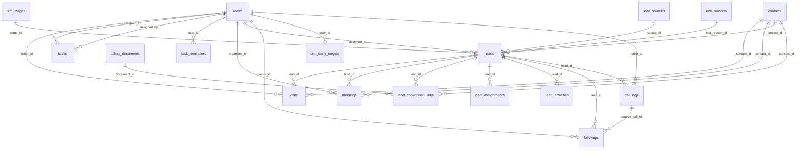

# Database schema & ERD

_Generated by `php spark dgr:docs` from the migrated MySQL database (`dgr_office`). Do not edit by hand._

- Tables: **122** · Foreign keys: **196**
- Engine InnoDB, charset utf8mb4; money is `DECIMAL(15,2)`, rates `DECIMAL(6,3)`, quantities `DECIMAL(14,3)` — no floating point.
- Shield tables (`users`, `auth_*`) and the Settings library table (`settings`) are created by their own migrations.

## ERD — Billing & finance

```mermaid
erDiagram
    ledger_accounts ||--o{ bank_cash_accounts : "ledger_account_id"
    branding_assets ||--o{ bank_cash_accounts : "qr_asset_id"
    bank_cash_accounts ||--o{ bank_import_lines : "bank_cash_account_id"
    bank_imports ||--o{ bank_import_lines : "bank_import_id"
    bank_cash_accounts ||--o{ bank_imports : "bank_cash_account_id"
    stored_files ||--o{ bank_imports : "stored_file_id"
    billing_documents ||--o{ billing_document_snapshots : "document_id"
    bank_cash_accounts ||--o{ billing_documents : "bank_account_id"
    contacts ||--o{ billing_documents : "contact_id"
    billing_documents ||--o{ billing_documents : "converted_from_id"
    financial_years ||--o{ billing_documents : "financial_year_id"
    journal_entries ||--o{ billing_documents : "journal_entry_id"
    leads ||--o{ billing_documents : "lead_id"
    billing_documents ||--o{ billing_documents : "original_document_id"
    states ||--o{ billing_documents : "place_of_supply_state_code"
    document_sequences ||--o{ billing_documents : "sequence_id"
    document_templates ||--o{ billing_documents : "template_id"
    billing_documents ||--o{ billing_line_items : "document_id"
    services ||--o{ billing_line_items : "service_id"
    tax_treatments ||--o{ billing_line_items : "tax_treatment"
    billing_documents ||--o{ billing_share_links : "document_id"
    billing_documents ||--o{ billing_taxes : "document_id"
    contacts ||--o{ contact_addresses : "contact_id"
    states ||--o{ contact_addresses : "state_code"
    contacts ||--o{ contact_files : "contact_id"
    stored_files ||--o{ contact_files : "stored_file_id"
    contacts ||--o{ contact_merges : "source_contact_id"
    contacts ||--o{ contact_merges : "target_contact_id"
    contacts ||--o{ contact_people : "contact_id"
    contacts ||--o{ contacts : "merged_into_id"
    states ||--o{ contacts : "state_code"
    billing_documents ||--o{ credit_debit_note_links : "note_document_id"
    billing_documents ||--o{ credit_debit_note_links : "original_document_id"
    financial_years ||--o{ document_sequences : "financial_year_id"
    itc_rules ||--o{ expense_categories : "default_itc_rule_id"
    ledger_accounts ||--o{ expense_categories : "ledger_account_id"
    expenses ||--o{ expense_files : "expense_id"
    stored_files ||--o{ expense_files : "stored_file_id"
    bank_cash_accounts ||--o{ expense_payments : "bank_cash_account_id"
    expenses ||--o{ expense_payments : "expense_id"
    journal_entries ||--o{ expense_payments : "journal_entry_id"
    expense_categories ||--o{ expenses : "category_id"
    itc_rules ||--o{ expenses : "itc_rule_id"
    journal_entries ||--o{ expenses : "journal_entry_id"
    employees ||--o{ expenses : "paid_by_employee_id"
    contacts ||--o{ expenses : "project_contact_id"
    recurring_expenses ||--o{ expenses : "recurring_expense_id"
    contacts ||--o{ expenses : "vendor_contact_id"
    financial_years ||--o{ journal_entries : "financial_year_id"
    journal_entries ||--o{ journal_entries : "reversal_of_id"
    bank_cash_accounts ||--o{ journal_lines : "bank_cash_account_id"
    contacts ||--o{ journal_lines : "contact_id"
    employees ||--o{ journal_lines : "employee_id"
    journal_entries ||--o{ journal_lines : "journal_entry_id"
    ledger_accounts ||--o{ journal_lines : "ledger_account_id"
    ledger_accounts ||--o{ ledger_accounts : "parent_id"
    bank_cash_accounts ||--o{ money_transfers : "from_account_id"
    journal_entries ||--o{ money_transfers : "journal_entry_id"
    bank_cash_accounts ||--o{ money_transfers : "to_account_id"
    billing_documents ||--o{ payment_allocations : "document_id"
    payment_receipts ||--o{ payment_allocations : "receipt_id"
    bank_cash_accounts ||--o{ payment_receipts : "bank_cash_account_id"
    contacts ||--o{ payment_receipts : "contact_id"
    financial_years ||--o{ payment_receipts : "financial_year_id"
    journal_entries ||--o{ payment_receipts : "journal_entry_id"
    payment_receipts ||--o{ payment_receipts : "refund_of_receipt_id"
    document_sequences ||--o{ payment_receipts : "sequence_id"
    bank_import_lines ||--o{ reconciliation_matches : "bank_import_line_id"
    recurring_billing_profiles ||--o{ recurring_billing_lines : "profile_id"
    services ||--o{ recurring_billing_lines : "service_id"
    contacts ||--o{ recurring_billing_profiles : "contact_id"
    expense_categories ||--o{ recurring_expenses : "category_id"
    contacts ||--o{ recurring_expenses : "vendor_contact_id"
    tax_rates ||--o{ services : "default_tax_rate_id"
    tax_treatments ||--o{ services : "default_tax_treatment"
    billing_documents ||--o{ signature_usage_log : "document_id"
    users ||--o{ signature_usage_log : "user_id"
```

## ERD — CRM & sync

## ERD — HR, payroll & AI

```mermaid
erDiagram
    ai_capabilities ||--o{ ai_access_grants : "capability"
    ai_service_tokens ||--o{ ai_access_grants : "token_id"
    candidate_documents ||--o{ ai_cv_evaluations : "candidate_document_id"
    candidates ||--o{ ai_cv_evaluations : "candidate_id"
    ai_access_grants ||--o{ ai_cv_evaluations : "grant_id"
    job_description_versions ||--o{ ai_cv_evaluations : "jd_version_id"
    ai_service_accounts ||--o{ ai_service_tokens : "service_account_id"
    employees ||--o{ attendance : "employee_id"
    leave_requests ||--o{ attendance : "leave_request_id"
    candidates ||--o{ candidate_documents : "candidate_id"
    stored_files ||--o{ candidate_documents : "stored_file_id"
    job_description_versions ||--o{ candidates : "applied_jd_version_id"
    employees ||--o{ candidates : "employee_id"
    job_openings ||--o{ candidates : "job_opening_id"
    users ||--o{ candidates : "recruiter_id"
    departments ||--o{ designations : "department_id"
    bank_cash_accounts ||--o{ employee_advances : "bank_cash_account_id"
    employees ||--o{ employee_advances : "employee_id"
    employees ||--o{ employee_bank_details : "employee_id"
    employees ||--o{ employee_documents : "employee_id"
    stored_files ||--o{ employee_documents : "stored_file_id"
    candidates ||--o{ employees : "candidate_id"
    departments ||--o{ employees : "department_id"
    designations ||--o{ employees : "designation_id"
    employees ||--o{ employees : "reporting_manager_id"
    users ||--o{ employees : "user_id"
    incentive_entries ||--o{ incentive_entries : "clawback_of_id"
    billing_documents ||--o{ incentive_entries : "document_id"
    employees ||--o{ incentive_entries : "employee_id"
    leads ||--o{ incentive_entries : "lead_id"
    payroll_items ||--o{ incentive_entries : "payroll_item_id"
    incentive_policies ||--o{ incentive_entries : "policy_id"
    payment_receipts ||--o{ incentive_entries : "receipt_id"
    interviews ||--o{ interview_scorecards : "interview_id"
    stored_files ||--o{ interviews : "attachment_file_id"
    candidates ||--o{ interviews : "candidate_id"
    users ||--o{ interviews : "interviewer_id"
    stored_files ||--o{ job_description_versions : "attachment_file_id"
    job_openings ||--o{ job_description_versions : "job_opening_id"
    job_description_versions ||--o{ job_openings : "current_jd_version_id"
    departments ||--o{ job_openings : "department_id"
    users ||--o{ job_openings : "interviewer_user_id"
    users ||--o{ job_openings : "recruiter_user_id"
    employees ||--o{ leave_balances : "employee_id"
    financial_years ||--o{ leave_balances : "financial_year_id"
    leave_types ||--o{ leave_balances : "leave_type_id"
    employees ||--o{ leave_requests : "employee_id"
    leave_types ||--o{ leave_requests : "leave_type_id"
    journal_entries ||--o{ payroll_adjustments : "journal_entry_id"
    payroll_items ||--o{ payroll_adjustments : "payroll_item_id"
    payroll_runs ||--o{ payroll_adjustments : "payroll_run_id"
    payroll_items ||--o{ payroll_item_components : "payroll_item_id"
    employees ||--o{ payroll_items : "employee_id"
    payroll_runs ||--o{ payroll_items : "payroll_run_id"
    salary_structures ||--o{ payroll_items : "salary_structure_id"
    bank_cash_accounts ||--o{ payroll_payments : "bank_cash_account_id"
    journal_entries ||--o{ payroll_payments : "journal_entry_id"
    payroll_items ||--o{ payroll_payments : "payroll_item_id"
    payroll_runs ||--o{ payroll_payments : "payroll_run_id"
    journal_entries ||--o{ payroll_runs : "journal_entry_id"
    payroll_items ||--o{ payslips : "payroll_item_id"
    stored_files ||--o{ payslips : "stored_file_id"
    ai_cv_evaluations ||--o{ recruitment_events : "ai_evaluation_id"
    candidates ||--o{ recruitment_events : "candidate_id"
    salary_structures ||--o{ salary_structure_components : "salary_structure_id"
    employees ||--o{ salary_structures : "employee_id"
```

## Tables

### `ai_access_grants`

| Column | Type | Null | Default | Key | Notes |
|---|---|---|---|---|---|
| `id` | bigint unsigned | NO |  | PRI |  |
| `capability` | varchar(60) | NO |  | MUL |  |
| `token_id` | int unsigned | YES |  | MUL |  |
| `record_type` | varchar(40) | NO |  |  |  |
| `record_id` | bigint unsigned | NO |  |  |  |
| `allowed_fields` | json | NO |  |  |  |
| `purpose` | varchar(255) | NO |  |  |  |
| `requested_by` | int unsigned | YES |  |  |  |
| `expires_at` | datetime | NO |  |  |  |
| `consumed_at` | datetime | YES |  |  |  |
| `created_at` | datetime | NO | `CURRENT_TIMESTAMP` |  |  |

Foreign keys: `capability` → `ai_capabilities.code`, `token_id` → `ai_service_tokens.id`

### `ai_action_logs`

| Column | Type | Null | Default | Key | Notes |
|---|---|---|---|---|---|
| `id` | bigint unsigned | NO |  | PRI |  |
| `occurred_at` | datetime | NO | `CURRENT_TIMESTAMP` | MUL |  |
| `capability` | varchar(60) | YES |  | MUL |  |
| `token_id` | int unsigned | YES |  |  |  |
| `grant_id` | bigint unsigned | YES |  |  |  |
| `actor_user_id` | int unsigned | YES |  |  |  |
| `record_type` | varchar(40) | YES |  |  |  |
| `record_ids` | json | YES |  |  |  |
| `field_names` | json | YES |  |  | names only — never contents |
| `provider` | varchar(40) | YES |  |  |  |
| `model` | varchar(80) | YES |  |  |  |
| `outcome` | enum('allowed','denied','error','completed','fallback') | NO |  |  |  |
| `deny_reason` | varchar(255) | YES |  |  |  |
| `http_path` | varchar(255) | YES |  |  |  |
| `input_tokens` | int unsigned | YES |  |  |  |
| `output_tokens` | int unsigned | YES |  |  |  |
| `cost_estimate` | decimal(10,4) | YES |  |  |  |
| `duration_ms` | int unsigned | YES |  |  |  |

### `ai_capabilities`

| Column | Type | Null | Default | Key | Notes |
|---|---|---|---|---|---|
| `code` | varchar(60) | NO |  | PRI |  |
| `label` | varchar(200) | NO |  |  |  |
| `enabled` | tinyint(1) | NO | `0` |  |  |
| `allowed_fields` | json | NO |  |  |  |
| `scope_config` | json | YES |  |  | e.g. allowlisted employee ids |
| `share_with_provider` | tinyint(1) | NO | `0` |  |  |
| `requires_consent` | tinyint(1) | NO | `1` |  |  |
| `rate_limit_per_hour` | smallint unsigned | NO | `30` |  |  |
| `monthly_cost_ceiling` | decimal(10,2) | NO | `0.00` |  | USD, 0 = feature blocked |
| `retention_days` | smallint unsigned | NO | `180` |  |  |
| `updated_by` | int unsigned | YES |  |  |  |
| `updated_at` | datetime | YES |  |  |  |

### `ai_cv_evaluations`

| Column | Type | Null | Default | Key | Notes |
|---|---|---|---|---|---|
| `id` | bigint unsigned | NO |  | PRI |  |
| `candidate_id` | bigint unsigned | NO |  | MUL |  |
| `candidate_document_id` | bigint unsigned | YES |  | MUL |  |
| `jd_version_id` | int unsigned | NO |  | MUL |  |
| `engine` | enum('ai','rules') | NO |  |  |  |
| `provider` | varchar(40) | YES |  |  |  |
| `model` | varchar(80) | YES |  |  |  |
| `prompt_version` | varchar(20) | YES |  |  |  |
| `status` | enum('completed','unavailable','failed') | NO |  |  |  |
| `fit_score` | decimal(3,1) | YES |  |  |  |
| `category_scores` | json | YES |  |  |  |
| `matched_requirements` | json | YES |  |  |  |
| `unmet_requirements` | json | YES |  |  |  |
| `unclear_requirements` | json | YES |  |  |  |
| `interview_questions` | json | YES |  |  |  |
| `summary` | text | YES |  |  |  |
| `explanation` | text | YES |  |  |  |
| `confidence` | enum('low','medium','high') | YES |  |  |  |
| `injection_flags` | json | YES |  |  |  |
| `error_message` | varchar(500) | YES |  |  |  |
| `input_tokens` | int unsigned | YES |  |  |  |
| `output_tokens` | int unsigned | YES |  |  |  |
| `cost_estimate` | decimal(10,4) | YES |  |  |  |
| `grant_id` | bigint unsigned | YES |  | MUL |  |
| `requested_by` | int unsigned | YES |  |  |  |
| `hr_decision` | enum('pending','accepted','overridden') | NO | `pending` |  |  |
| `hr_score` | decimal(3,1) | YES |  |  |  |
| `hr_override_reason` | varchar(1000) | YES |  |  |  |
| `reviewed_by` | int unsigned | YES |  |  |  |
| `reviewed_at` | datetime | YES |  |  |  |
| `created_at` | datetime | NO | `CURRENT_TIMESTAMP` |  |  |

Foreign keys: `candidate_document_id` → `candidate_documents.id`, `candidate_id` → `candidates.id`, `grant_id` → `ai_access_grants.id`, `jd_version_id` → `job_description_versions.id`

Check constraints: `chk_ace_score`

### `ai_service_accounts`

| Column | Type | Null | Default | Key | Notes |
|---|---|---|---|---|---|
| `id` | int unsigned | NO |  | PRI |  |
| `name` | varchar(100) | NO |  | UNI |  |
| `description` | varchar(255) | YES |  |  |  |
| `is_active` | tinyint(1) | NO | `1` |  |  |
| `revoked_at` | datetime | YES |  |  |  |
| `created_by` | int unsigned | YES |  |  |  |
| `updated_by` | int unsigned | YES |  |  |  |
| `created_at` | datetime | NO | `CURRENT_TIMESTAMP` |  |  |
| `updated_at` | datetime | YES |  |  |  |

### `ai_service_tokens`

| Column | Type | Null | Default | Key | Notes |
|---|---|---|---|---|---|
| `id` | int unsigned | NO |  | PRI |  |
| `service_account_id` | int unsigned | NO |  | MUL |  |
| `token_hash` | char(64) | NO |  | UNI |  |
| `token_hint` | char(8) | NO |  |  |  |
| `capabilities` | json | NO |  |  |  |
| `scope` | json | YES |  |  | record allowlist e.g. {candidate_ids:[..]} or {employee_ids:[..], period:..} |
| `purpose` | varchar(255) | NO |  |  |  |
| `expires_at` | datetime | NO |  |  |  |
| `max_uses` | int unsigned | YES |  |  |  |
| `use_count` | int unsigned | NO | `0` |  |  |
| `last_used_at` | datetime | YES |  |  |  |
| `revoked_at` | datetime | YES |  |  |  |
| `revoked_by` | int unsigned | YES |  |  |  |
| `created_by` | int unsigned | YES |  |  |  |
| `created_at` | datetime | NO | `CURRENT_TIMESTAMP` |  |  |

Foreign keys: `service_account_id` → `ai_service_accounts.id`

### `app_settings`

| Column | Type | Null | Default | Key | Notes |
|---|---|---|---|---|---|
| `setting_key` | varchar(100) | NO |  | PRI |  |
| `setting_value` | text | YES |  |  |  |
| `value_type` | enum('string','int','bool','json','decimal') | NO | `string` |  |  |
| `updated_by` | int unsigned | YES |  |  |  |
| `updated_at` | datetime | YES |  |  |  |

### `attendance`

| Column | Type | Null | Default | Key | Notes |
|---|---|---|---|---|---|
| `id` | bigint unsigned | NO |  | PRI |  |
| `employee_id` | bigint unsigned | NO |  | MUL |  |
| `att_date` | date | NO |  | MUL |  |
| `status` | enum('present','absent','half_day','leave','holiday','week_off') | NO |  |  |  |
| `leave_request_id` | bigint unsigned | YES |  | MUL |  |
| `check_in_at` | datetime | YES |  |  |  |
| `check_out_at` | datetime | YES |  |  |  |
| `overtime_minutes` | smallint unsigned | NO | `0` |  |  |
| `source` | enum('manual','self','system') | NO | `manual` |  |  |
| `remarks` | varchar(255) | YES |  |  |  |
| `corrected` | tinyint(1) | NO | `0` |  |  |
| `correction_reason` | varchar(500) | YES |  |  |  |
| `created_by` | int unsigned | YES |  |  |  |
| `updated_by` | int unsigned | YES |  |  |  |
| `created_at` | datetime | NO | `CURRENT_TIMESTAMP` |  |  |
| `updated_at` | datetime | YES |  |  |  |

Foreign keys: `employee_id` → `employees.id`, `leave_request_id` → `leave_requests.id`

### `audit_logs`

| Column | Type | Null | Default | Key | Notes |
|---|---|---|---|---|---|
| `id` | bigint unsigned | NO |  | PRI |  |
| `occurred_at` | datetime(6) | NO | `CURRENT_TIMESTAMP(6)` | MUL |  |
| `user_id` | int unsigned | YES |  | MUL |  |
| `actor_type` | enum('user','system','cron','ai_service') | NO | `user` |  |  |
| `action` | varchar(80) | NO |  | MUL |  |
| `entity_type` | varchar(60) | YES |  | MUL |  |
| `entity_id` | bigint unsigned | YES |  |  |  |
| `summary` | varchar(255) | YES |  |  |  |
| `before_data` | json | YES |  |  |  |
| `after_data` | json | YES |  |  |  |
| `meta` | json | YES |  |  |  |
| `ip_address` | varchar(45) | YES |  |  |  |
| `user_agent` | varchar(255) | YES |  |  |  |
| `prev_hash` | char(64) | YES |  |  |  |
| `row_hash` | char(64) | NO |  |  | sha256 chain for tamper evidence |

### `auth_groups_users`

| Column | Type | Null | Default | Key | Notes |
|---|---|---|---|---|---|
| `id` | int unsigned | NO |  | PRI |  |
| `user_id` | int unsigned | NO |  | MUL |  |
| `group` | varchar(255) | NO |  |  |  |
| `created_at` | datetime | NO |  |  |  |

Foreign keys: `user_id` → `users.id`

### `auth_identities`

| Column | Type | Null | Default | Key | Notes |
|---|---|---|---|---|---|
| `id` | int unsigned | NO |  | PRI |  |
| `user_id` | int unsigned | NO |  | MUL |  |
| `type` | varchar(255) | NO |  | MUL |  |
| `name` | varchar(255) | YES |  |  |  |
| `secret` | varchar(255) | NO |  |  |  |
| `secret2` | varchar(255) | YES |  |  |  |
| `expires` | datetime | YES |  |  |  |
| `extra` | text | YES |  |  |  |
| `force_reset` | tinyint(1) | NO | `0` |  |  |
| `last_used_at` | datetime | YES |  |  |  |
| `created_at` | datetime | YES |  |  |  |
| `updated_at` | datetime | YES |  |  |  |

Foreign keys: `user_id` → `users.id`

### `auth_logins`

| Column | Type | Null | Default | Key | Notes |
|---|---|---|---|---|---|
| `id` | int unsigned | NO |  | PRI |  |
| `ip_address` | varchar(255) | NO |  |  |  |
| `user_agent` | varchar(255) | YES |  |  |  |
| `id_type` | varchar(255) | NO |  | MUL |  |
| `identifier` | varchar(255) | NO |  |  |  |
| `user_id` | int unsigned | YES |  | MUL |  |
| `date` | datetime | NO |  |  |  |
| `success` | tinyint(1) | NO |  |  |  |

### `auth_permissions_users`

| Column | Type | Null | Default | Key | Notes |
|---|---|---|---|---|---|
| `id` | int unsigned | NO |  | PRI |  |
| `user_id` | int unsigned | NO |  | MUL |  |
| `permission` | varchar(255) | NO |  |  |  |
| `created_at` | datetime | NO |  |  |  |

Foreign keys: `user_id` → `users.id`

### `auth_remember_tokens`

| Column | Type | Null | Default | Key | Notes |
|---|---|---|---|---|---|
| `id` | int unsigned | NO |  | PRI |  |
| `selector` | varchar(255) | NO |  | UNI |  |
| `hashedValidator` | varchar(255) | NO |  |  |  |
| `user_id` | int unsigned | NO |  | MUL |  |
| `expires` | datetime | NO |  |  |  |
| `created_at` | datetime | NO |  |  |  |
| `updated_at` | datetime | NO |  |  |  |

Foreign keys: `user_id` → `users.id`

### `auth_token_logins`

| Column | Type | Null | Default | Key | Notes |
|---|---|---|---|---|---|
| `id` | int unsigned | NO |  | PRI |  |
| `ip_address` | varchar(255) | NO |  |  |  |
| `user_agent` | varchar(255) | YES |  |  |  |
| `id_type` | varchar(255) | NO |  | MUL |  |
| `identifier` | varchar(255) | NO |  |  |  |
| `user_id` | int unsigned | YES |  | MUL |  |
| `date` | datetime | NO |  |  |  |
| `success` | tinyint(1) | NO |  |  |  |

### `bank_cash_accounts`

| Column | Type | Null | Default | Key | Notes |
|---|---|---|---|---|---|
| `id` | int unsigned | NO |  | PRI |  |
| `code` | varchar(30) | NO |  | UNI |  |
| `account_kind` | enum('cash','bank','upi_clearing','card_clearing','other') | NO |  |  |  |
| `ownership` | enum('company','owner_personal','other') | NO | `company` |  |  |
| `classification_note` | varchar(255) | YES |  |  | accountant-reviewed treatment of personal accounts |
| `display_name` | varchar(120) | NO |  |  |  |
| `bank_name` | varchar(120) | YES |  |  |  |
| `beneficiary_name` | varchar(150) | YES |  |  |  |
| `account_number_enc` | text | YES |  |  | encrypted |
| `account_last4` | char(4) | YES |  |  |  |
| `ifsc` | char(11) | YES |  |  |  |
| `branch` | varchar(120) | YES |  |  |  |
| `account_type` | enum('current','savings','od','cc','wallet','other') | YES |  |  |  |
| `upi_id` | varchar(100) | YES |  |  |  |
| `cif_enc` | text | YES |  |  | encrypted; internal only, never printed/exported/sent to AI |
| `qr_asset_id` | int unsigned | YES |  | MUL |  |
| `display_priority` | smallint | NO | `100` |  |  |
| `show_on_invoice` | tinyint(1) | NO | `0` |  |  |
| `is_default_on_invoice` | tinyint(1) | NO | `0` |  |  |
| `print_approved_by` | int unsigned | YES |  |  | required before a personal account can be printed |
| `print_approved_at` | datetime | YES |  |  |  |
| `ledger_account_id` | int unsigned | NO |  | UNI |  |
| `opening_balance` | decimal(15,2) | NO | `0.00` |  |  |
| `opening_date` | date | YES |  |  |  |
| `requires_review` | tinyint(1) | NO | `0` |  | flag receipts for reconciliation review |
| `is_active` | tinyint(1) | NO | `1` |  |  |
| `created_by` | int unsigned | YES |  |  |  |
| `updated_by` | int unsigned | YES |  |  |  |
| `created_at` | datetime | NO | `CURRENT_TIMESTAMP` |  |  |
| `updated_at` | datetime | YES |  |  |  |

Foreign keys: `ledger_account_id` → `ledger_accounts.id`, `qr_asset_id` → `branding_assets.id`

### `bank_import_lines`

| Column | Type | Null | Default | Key | Notes |
|---|---|---|---|---|---|
| `id` | bigint unsigned | NO |  | PRI |  |
| `bank_import_id` | int unsigned | NO |  | MUL |  |
| `bank_cash_account_id` | int unsigned | NO |  | MUL |  |
| `txn_date` | date | NO |  |  |  |
| `value_date` | date | YES |  |  |  |
| `description` | varchar(500) | YES |  |  |  |
| `reference` | varchar(120) | YES |  |  |  |
| `debit` | decimal(15,2) | NO | `0.00` |  |  |
| `credit` | decimal(15,2) | NO | `0.00` |  |  |
| `balance` | decimal(15,2) | YES |  |  |  |
| `line_hash` | char(64) | NO |  |  | dedupe: account+date+amounts+ref+desc |
| `match_status` | enum('unmatched','partial','matched','ignored') | NO | `unmatched` |  |  |
| `matched_amount` | decimal(15,2) | NO | `0.00` |  |  |
| `created_at` | datetime | NO | `CURRENT_TIMESTAMP` |  |  |

Foreign keys: `bank_cash_account_id` → `bank_cash_accounts.id`, `bank_import_id` → `bank_imports.id`

### `bank_imports`

| Column | Type | Null | Default | Key | Notes |
|---|---|---|---|---|---|
| `id` | int unsigned | NO |  | PRI |  |
| `bank_cash_account_id` | int unsigned | NO |  | MUL |  |
| `stored_file_id` | bigint unsigned | YES |  | MUL |  |
| `original_name` | varchar(255) | NO |  |  |  |
| `statement_from` | date | YES |  |  |  |
| `statement_to` | date | YES |  |  |  |
| `rows_total` | int unsigned | NO | `0` |  |  |
| `rows_imported` | int unsigned | NO | `0` |  |  |
| `rows_duplicate` | int unsigned | NO | `0` |  |  |
| `rows_error` | int unsigned | NO | `0` |  |  |
| `imported_by` | int unsigned | YES |  |  |  |
| `imported_at` | datetime | NO | `CURRENT_TIMESTAMP` |  |  |

Foreign keys: `bank_cash_account_id` → `bank_cash_accounts.id`, `stored_file_id` → `stored_files.id`

### `billing_document_snapshots`

| Column | Type | Null | Default | Key | Notes |
|---|---|---|---|---|---|
| `id` | bigint unsigned | NO |  | PRI |  |
| `document_id` | bigint unsigned | NO |  | UNI |  |
| `supplier` | json | NO |  |  | legal identity as at issuance |
| `customer` | json | NO |  |  |  |
| `bank` | json | YES |  |  | only fields actually printed — never CIF |
| `branding` | json | YES |  |  | asset ids, versions, sha256 |
| `template` | json | NO |  |  |  |
| `line_items` | json | NO |  |  |  |
| `tax_summary` | json | NO |  |  |  |
| `totals` | json | NO |  |  |  |
| `content_hash` | char(64) | NO |  |  |  |
| `created_at` | datetime | NO | `CURRENT_TIMESTAMP` |  |  |

Foreign keys: `document_id` → `billing_documents.id`

### `billing_documents`

| Column | Type | Null | Default | Key | Notes |
|---|---|---|---|---|---|
| `id` | bigint unsigned | NO |  | PRI |  |
| `doc_type` | enum('tax_invoice','bill_of_supply','cash_memo','estimate','quotation','proforma','credit_note','debit_note') | NO |  | MUL |  |
| `status` | enum('draft','finalized','cancelled','converted','expired') | NO | `draft` |  |  |
| `draft_ref` | varchar(20) | NO |  | UNI | internal id before finalization; never printed as statutory number |
| `sequence_id` | int unsigned | YES |  | MUL |  |
| `sequence_number` | int unsigned | YES |  |  |  |
| `document_number` | varchar(16) | YES |  |  | assigned only at finalization |
| `financial_year_id` | int unsigned | YES |  | MUL |  |
| `contact_id` | bigint unsigned | NO |  | MUL |  |
| `issue_date` | date | NO |  |  |  |
| `supply_date` | date | YES |  |  |  |
| `service_period_from` | date | YES |  |  |  |
| `service_period_to` | date | YES |  |  |  |
| `due_date` | date | YES |  |  |  |
| `reference_no` | varchar(60) | YES |  |  |  |
| `po_number` | varchar(60) | YES |  |  |  |
| `bill_to_name` | varchar(200) | NO |  |  |  |
| `bill_to_gstin` | char(15) | YES |  |  |  |
| `bill_to_address` | text | YES |  |  |  |
| `bill_to_state_code` | char(2) | YES |  |  |  |
| `bill_to_phone` | varchar(20) | YES |  |  |  |
| `bill_to_email` | varchar(150) | YES |  |  |  |
| `customer_type` | enum('b2b','b2c','export','sez') | NO | `b2c` |  |  |
| `supplier_gstin` | char(15) | YES |  |  |  |
| `supplier_state_code` | char(2) | YES |  |  |  |
| `place_of_supply_state_code` | char(2) | YES |  | MUL |  |
| `is_sez_recipient` | tinyint(1) | NO | `0` |  |  |
| `export_type` | enum('none','with_payment','lut') | NO | `none` |  |  |
| `gst_type` | enum('cgst_sgst','cgst_utgst','igst','none') | YES |  |  |  |
| `reverse_charge` | tinyint(1) | NO | `0` |  |  |
| `tax_review_status` | enum('auto_ok','needs_review','resolved','blocked') | NO | `needs_review` |  |  |
| `tax_review_reason` | text | YES |  |  |  |
| `tax_reviewed_by` | int unsigned | YES |  |  |  |
| `tax_reviewed_at` | datetime | YES |  |  |  |
| `tax_advice` | json | YES |  |  | suggestion + warnings at last calculation |
| `price_mode` | enum('exclusive','inclusive') | NO | `exclusive` |  |  |
| `subtotal` | decimal(15,2) | NO | `0.00` |  |  |
| `discount_total` | decimal(15,2) | NO | `0.00` |  |  |
| `taxable_total` | decimal(15,2) | NO | `0.00` |  |  |
| `cgst_total` | decimal(15,2) | NO | `0.00` |  |  |
| `sgst_total` | decimal(15,2) | NO | `0.00` |  |  |
| `utgst_total` | decimal(15,2) | NO | `0.00` |  |  |
| `igst_total` | decimal(15,2) | NO | `0.00` |  |  |
| `cess_total` | decimal(15,2) | NO | `0.00` |  |  |
| `tax_total` | decimal(15,2) | NO | `0.00` |  |  |
| `round_off` | decimal(15,2) | NO | `0.00` |  |  |
| `grand_total` | decimal(15,2) | NO | `0.00` |  |  |
| `amount_paid` | decimal(15,2) | NO | `0.00` |  | derived from payment_allocations |
| `amount_credited` | decimal(15,2) | NO | `0.00` |  | derived from finalized credit notes |
| `balance_due` | decimal(15,2) | NO | `0.00` |  |  |
| `payment_status` | enum('na','unpaid','partial','paid','overpaid') | NO | `na` |  |  |
| `amount_in_words` | varchar(300) | YES |  |  |  |
| `notes` | text | YES |  |  |  |
| `terms` | text | YES |  |  |  |
| `internal_notes` | text | YES |  |  |  |
| `bank_account_id` | int unsigned | YES |  | MUL |  |
| `template_id` | int unsigned | YES |  | MUL |  |
| `template_version` | int unsigned | YES |  |  |  |
| `apply_signature` | tinyint(1) | NO | `0` |  |  |
| `signed_by` | int unsigned | YES |  |  |  |
| `signed_at` | datetime | YES |  |  |  |
| `original_document_id` | bigint unsigned | YES |  | MUL | credit/debit note → original invoice |
| `converted_from_id` | bigint unsigned | YES |  | MUL | estimate → invoice |
| `duplicated_from_id` | bigint unsigned | YES |  |  |  |
| `recurring_profile_id` | int unsigned | YES |  |  |  |
| `lead_id` | bigint unsigned | YES |  | MUL |  |
| `journal_entry_id` | bigint unsigned | YES |  | MUL |  |
| `einvoice_irn` | varchar(64) | YES |  |  | only when a real IRP integration exists |
| `einvoice_ack_no` | varchar(30) | YES |  |  |  |
| `einvoice_ack_date` | datetime | YES |  |  |  |
| `cancel_reason` | varchar(500) | YES |  |  |  |
| `cancelled_by` | int unsigned | YES |  |  |  |
| `cancelled_at` | datetime | YES |  |  |  |
| `lock_version` | int unsigned | NO | `1` |  | optimistic lock for drafts/autosave |
| `finalized_by` | int unsigned | YES |  |  |  |
| `finalized_at` | datetime | YES |  |  |  |
| `created_by` | int unsigned | YES |  | MUL |  |
| `updated_by` | int unsigned | YES |  |  |  |
| `created_at` | datetime | NO | `CURRENT_TIMESTAMP` |  |  |
| `updated_at` | datetime | YES |  |  |  |

Foreign keys: `bank_account_id` → `bank_cash_accounts.id`, `contact_id` → `contacts.id`, `converted_from_id` → `billing_documents.id`, `financial_year_id` → `financial_years.id`, `journal_entry_id` → `journal_entries.id`, `lead_id` → `leads.id`, `original_document_id` → `billing_documents.id`, `place_of_supply_state_code` → `states.code`, `sequence_id` → `document_sequences.id`, `template_id` → `document_templates.id`

Check constraints: `chk_bd_final_number`

### `billing_line_items`

| Column | Type | Null | Default | Key | Notes |
|---|---|---|---|---|---|
| `id` | bigint unsigned | NO |  | PRI |  |
| `document_id` | bigint unsigned | NO |  | MUL |  |
| `line_no` | smallint unsigned | NO |  |  |  |
| `service_id` | int unsigned | YES |  | MUL |  |
| `item_name` | varchar(200) | NO |  |  |  |
| `description` | text | YES |  |  |  |
| `sac_code` | varchar(8) | YES |  |  |  |
| `qty` | decimal(14,3) | NO | `1.000` |  |  |
| `unit` | varchar(20) | YES |  |  |  |
| `unit_rate` | decimal(15,4) | NO | `0.0000` |  |  |
| `discount_type` | enum('amount','percent') | NO | `amount` |  |  |
| `discount_value` | decimal(15,4) | NO | `0.0000` |  |  |
| `gross_amount` | decimal(15,2) | NO | `0.00` |  |  |
| `discount_amount` | decimal(15,2) | NO | `0.00` |  |  |
| `taxable_value` | decimal(15,2) | NO | `0.00` |  |  |
| `tax_treatment` | varchar(30) | NO | `regular` | MUL |  |
| `gst_rate` | decimal(6,3) | NO | `0.000` |  |  |
| `cgst_rate` | decimal(6,3) | NO | `0.000` |  |  |
| `cgst_amount` | decimal(15,2) | NO | `0.00` |  |  |
| `sgst_rate` | decimal(6,3) | NO | `0.000` |  |  |
| `sgst_amount` | decimal(15,2) | NO | `0.00` |  |  |
| `utgst_rate` | decimal(6,3) | NO | `0.000` |  |  |
| `utgst_amount` | decimal(15,2) | NO | `0.00` |  |  |
| `igst_rate` | decimal(6,3) | NO | `0.000` |  |  |
| `igst_amount` | decimal(15,2) | NO | `0.00` |  |  |
| `cess_rate` | decimal(6,3) | NO | `0.000` |  |  |
| `cess_amount` | decimal(15,2) | NO | `0.00` |  |  |
| `line_total` | decimal(15,2) | NO | `0.00` |  |  |
| `created_by` | int unsigned | YES |  |  |  |
| `updated_by` | int unsigned | YES |  |  |  |
| `created_at` | datetime | NO | `CURRENT_TIMESTAMP` |  |  |
| `updated_at` | datetime | YES |  |  |  |

Foreign keys: `document_id` → `billing_documents.id`, `service_id` → `services.id`, `tax_treatment` → `tax_treatments.code`

Check constraints: `chk_bli_split`; `chk_bli_state`

### `billing_share_links`

| Column | Type | Null | Default | Key | Notes |
|---|---|---|---|---|---|
| `id` | bigint unsigned | NO |  | PRI |  |
| `document_id` | bigint unsigned | NO |  | MUL |  |
| `token_hash` | char(64) | NO |  | UNI |  |
| `expires_at` | datetime | NO |  |  |  |
| `revoked_at` | datetime | YES |  |  |  |
| `access_count` | int unsigned | NO | `0` |  |  |
| `created_by` | int unsigned | YES |  |  |  |
| `created_at` | datetime | NO | `CURRENT_TIMESTAMP` |  |  |

Foreign keys: `document_id` → `billing_documents.id`

### `billing_taxes`

| Column | Type | Null | Default | Key | Notes |
|---|---|---|---|---|---|
| `id` | bigint unsigned | NO |  | PRI |  |
| `document_id` | bigint unsigned | NO |  | MUL |  |
| `tax_type` | enum('CGST','SGST','UTGST','IGST','CESS') | NO |  |  |  |
| `rate` | decimal(6,3) | NO |  |  |  |
| `taxable_value` | decimal(15,2) | NO |  |  |  |
| `tax_amount` | decimal(15,2) | NO |  |  |  |

Foreign keys: `document_id` → `billing_documents.id`

### `branding_assets`

| Column | Type | Null | Default | Key | Notes |
|---|---|---|---|---|---|
| `id` | int unsigned | NO |  | PRI |  |
| `asset_type` | enum('logo','signature','stamp','sign_stamp','upi_qr','letterhead') | NO |  | MUL |  |
| `version` | int unsigned | NO |  |  |  |
| `stored_file_id` | bigint unsigned | NO |  | MUL |  |
| `width_px` | int unsigned | YES |  |  |  |
| `height_px` | int unsigned | YES |  |  |  |
| `position_preset` | enum('top_left','top_center','top_right','bottom_left','bottom_center','bottom_right') | NO | `top_left` |  |  |
| `display_width_mm` | decimal(5,1) | NO | `40.0` |  |  |
| `enabled_doc_types` | json | YES |  |  | doc types this asset may appear on |
| `bank_account_id` | int unsigned | YES |  | MUL | for UPI QR |
| `is_active` | tinyint(1) | NO | `1` |  |  |
| `replaced_at` | datetime | YES |  |  |  |
| `created_by` | int unsigned | YES |  |  |  |
| `updated_by` | int unsigned | YES |  |  |  |
| `created_at` | datetime | NO | `CURRENT_TIMESTAMP` |  |  |
| `updated_at` | datetime | YES |  |  |  |

Foreign keys: `bank_account_id` → `bank_cash_accounts.id`, `stored_file_id` → `stored_files.id`

### `call_logs`

| Column | Type | Null | Default | Key | Notes |
|---|---|---|---|---|---|
| `id` | bigint unsigned | NO |  | PRI |  |
| `lead_id` | bigint unsigned | NO |  | MUL |  |
| `called_at` | datetime | NO |  | MUL |  |
| `direction` | enum('outbound','inbound') | NO | `outbound` |  |  |
| `person_spoken` | varchar(150) | YES |  |  |  |
| `duration_seconds` | int unsigned | YES |  |  |  |
| `outcome` | enum('connected','interested','not_interested','call_back','no_answer','busy','switched_off','wrong_number','dnd_requested') | NO |  |  |  |
| `is_connected` | tinyint(1) | NO | `0` |  |  |
| `notes` | text | YES |  |  |  |
| `next_action` | varchar(255) | YES |  |  |  |
| `next_action_at` | datetime | YES |  |  |  |
| `followup_owner_id` | int unsigned | YES |  |  |  |
| `caller_id` | int unsigned | NO |  | MUL |  |
| `created_at` | datetime | NO | `CURRENT_TIMESTAMP` |  |  |

Foreign keys: `caller_id` → `users.id`, `lead_id` → `leads.id`

### `candidate_documents`

| Column | Type | Null | Default | Key | Notes |
|---|---|---|---|---|---|
| `id` | bigint unsigned | NO |  | PRI |  |
| `candidate_id` | bigint unsigned | NO |  | MUL |  |
| `doc_kind` | enum('cv','assignment','gd_notes','offer_letter','other') | NO | `cv` |  |  |
| `version_no` | smallint unsigned | NO | `1` |  |  |
| `stored_file_id` | bigint unsigned | NO |  | MUL |  |
| `parse_status` | enum('pending','parsed','failed','unsupported','not_applicable') | NO | `pending` |  |  |
| `parse_error` | varchar(500) | YES |  |  |  |
| `extracted_text` | mediumtext | YES |  |  |  |
| `text_sha256` | char(64) | YES |  |  |  |
| `is_current` | tinyint(1) | NO | `1` |  |  |
| `uploaded_by` | int unsigned | YES |  |  |  |
| `created_at` | datetime | NO | `CURRENT_TIMESTAMP` |  |  |

Foreign keys: `candidate_id` → `candidates.id`, `stored_file_id` → `stored_files.id`

### `candidates`

| Column | Type | Null | Default | Key | Notes |
|---|---|---|---|---|---|
| `id` | bigint unsigned | NO |  | PRI |  |
| `candidate_code` | varchar(20) | NO |  | UNI |  |
| `full_name` | varchar(150) | NO |  |  |  |
| `email` | varchar(150) | YES |  |  |  |
| `phone` | varchar(20) | YES |  |  |  |
| `phone_normalized` | varchar(15) | YES |  | MUL |  |
| `job_opening_id` | int unsigned | NO |  | MUL |  |
| `applied_jd_version_id` | int unsigned | YES |  | MUL |  |
| `application_date` | date | NO |  |  |  |
| `source` | varchar(80) | YES |  |  |  |
| `status` | enum('applied','resume_screened','hr_screening','interview_scheduled','interview_completed','assignment_gd','shortlisted','on_hold','rejected','offer_sent','offer_accepted','joined','withdrawn') | NO | `applied` |  |  |
| `expected_salary` | decimal(12,2) | YES |  |  | requires hr.salary.view |
| `available_from` | date | YES |  |  |  |
| `notice_period_days` | smallint unsigned | YES |  |  |  |
| `total_experience_years` | decimal(4,1) | YES |  |  |  |
| `linkedin_url` | varchar(255) | YES |  |  |  |
| `portfolio_url` | varchar(255) | YES |  |  |  |
| `extracted_skills` | json | YES |  |  |  |
| `extracted_education` | json | YES |  |  |  |
| `extracted_experience` | json | YES |  |  |  |
| `extracted_projects` | json | YES |  |  |  |
| `recruiter_notes` | text | YES |  |  |  |
| `recruiter_id` | int unsigned | YES |  | MUL |  |
| `consent_given` | tinyint(1) | NO | `0` |  |  |
| `consent_at` | datetime | YES |  |  |  |
| `consent_text_version` | varchar(20) | YES |  |  |  |
| `ai_share_consent` | tinyint(1) | NO | `0` |  | consent to send CV text to configured AI provider |
| `retention_until` | date | YES |  |  |  |
| `hr_score` | decimal(3,1) | YES |  |  |  |
| `employee_id` | bigint unsigned | YES |  | MUL |  |
| `created_by` | int unsigned | YES |  |  |  |
| `updated_by` | int unsigned | YES |  |  |  |
| `created_at` | datetime | NO | `CURRENT_TIMESTAMP` |  |  |
| `updated_at` | datetime | YES |  |  |  |
| `deleted_at` | datetime | YES |  |  |  |

Foreign keys: `applied_jd_version_id` → `job_description_versions.id`, `employee_id` → `employees.id`, `job_opening_id` → `job_openings.id`, `recruiter_id` → `users.id`

Check constraints: `chk_cand_score`

### `company_profile_versions`

| Column | Type | Null | Default | Key | Notes |
|---|---|---|---|---|---|
| `id` | int unsigned | NO |  | PRI |  |
| `profile_version` | int unsigned | NO |  | UNI |  |
| `data` | json | NO |  |  |  |
| `created_by` | int unsigned | YES |  |  |  |
| `created_at` | datetime | NO | `CURRENT_TIMESTAMP` |  |  |

### `company_settings`

| Column | Type | Null | Default | Key | Notes |
|---|---|---|---|---|---|
| `id` | tinyint unsigned | NO | `1` | PRI |  |
| `legal_name` | varchar(200) | YES |  |  |  |
| `trade_name` | varchar(200) | YES |  |  |  |
| `tagline` | varchar(200) | YES |  |  |  |
| `brand_description` | varchar(500) | YES |  |  |  |
| `gstin` | char(15) | YES |  |  |  |
| `pan` | char(10) | YES |  |  |  |
| `gst_registration_type` | enum('regular','composition','unregistered') | NO | `regular` |  |  |
| `state_code` | char(2) | YES |  | MUL |  |
| `reg_address_line1` | varchar(200) | YES |  |  |  |
| `reg_address_line2` | varchar(200) | YES |  |  |  |
| `reg_city` | varchar(80) | YES |  |  |  |
| `reg_district` | varchar(80) | YES |  |  |  |
| `reg_pincode` | char(6) | YES |  |  |  |
| `bill_address_same` | tinyint(1) | NO | `1` |  |  |
| `bill_address_line1` | varchar(200) | YES |  |  |  |
| `bill_address_line2` | varchar(200) | YES |  |  |  |
| `bill_city` | varchar(80) | YES |  |  |  |
| `bill_district` | varchar(80) | YES |  |  |  |
| `bill_state_code` | char(2) | YES |  | MUL |  |
| `bill_pincode` | char(6) | YES |  |  |  |
| `phone` | varchar(20) | YES |  |  |  |
| `alt_phone` | varchar(20) | YES |  |  |  |
| `email` | varchar(150) | YES |  |  |  |
| `alt_email` | varchar(150) | YES |  |  |  |
| `website` | varchar(150) | YES |  |  |  |
| `business_category` | varchar(150) | YES |  |  |  |
| `contact_persons` | json | YES |  |  |  |
| `einvoice_applicable` | tinyint(1) | NO | `0` |  | decision recorded by owner/accountant |
| `lut_number` | varchar(50) | YES |  |  |  |
| `lut_valid_till` | date | YES |  |  |  |
| `invoice_footer` | varchar(500) | YES |  |  |  |
| `invoice_terms` | text | YES |  |  |  |
| `legal_disclaimer` | varchar(500) | YES |  |  |  |
| `fy_start_month` | tinyint unsigned | NO | `4` |  |  |
| `currency` | char(3) | NO | `INR` |  |  |
| `timezone` | varchar(40) | NO | `Asia/Kolkata` |  |  |
| `default_payment_terms_days` | smallint unsigned | NO | `15` |  |  |
| `rounding_policy` | enum('none','nearest_rupee') | NO | `nearest_rupee` |  |  |
| `default_price_mode` | enum('exclusive','inclusive') | NO | `exclusive` |  |  |
| `default_template_id` | int unsigned | YES |  | MUL |  |
| `brand_primary` | varchar(9) | NO | `#111111` |  |  |
| `brand_accent` | varchar(9) | NO | `#B08D57` |  |  |
| `setup_steps` | json | YES |  |  | wizard completion status |
| `setup_completed_at` | datetime | YES |  |  |  |
| `profile_version` | int unsigned | NO | `1` |  |  |
| `created_by` | int unsigned | YES |  |  |  |
| `updated_by` | int unsigned | YES |  |  |  |
| `created_at` | datetime | NO | `CURRENT_TIMESTAMP` |  |  |
| `updated_at` | datetime | YES |  |  |  |

Foreign keys: `bill_state_code` → `states.code`, `default_template_id` → `document_templates.id`, `state_code` → `states.code`

Check constraints: `chk_cs_singleton`

### `contact_addresses`

| Column | Type | Null | Default | Key | Notes |
|---|---|---|---|---|---|
| `id` | bigint unsigned | NO |  | PRI |  |
| `contact_id` | bigint unsigned | NO |  | MUL |  |
| `address_type` | enum('billing','service','shipping','other') | NO | `billing` |  |  |
| `line1` | varchar(200) | NO |  |  |  |
| `line2` | varchar(200) | YES |  |  |  |
| `city` | varchar(80) | YES |  |  |  |
| `district` | varchar(80) | YES |  |  |  |
| `state_code` | char(2) | YES |  | MUL |  |
| `pincode` | char(6) | YES |  |  |  |
| `country` | char(2) | NO | `IN` |  |  |
| `is_default` | tinyint(1) | NO | `0` |  |  |
| `created_by` | int unsigned | YES |  |  |  |
| `updated_by` | int unsigned | YES |  |  |  |
| `created_at` | datetime | NO | `CURRENT_TIMESTAMP` |  |  |
| `updated_at` | datetime | YES |  |  |  |

Foreign keys: `contact_id` → `contacts.id`, `state_code` → `states.code`

### `contact_files`

| Column | Type | Null | Default | Key | Notes |
|---|---|---|---|---|---|
| `id` | bigint unsigned | NO |  | PRI |  |
| `contact_id` | bigint unsigned | NO |  | MUL |  |
| `stored_file_id` | bigint unsigned | NO |  | MUL |  |
| `label` | varchar(150) | YES |  |  |  |
| `created_by` | int unsigned | YES |  |  |  |
| `created_at` | datetime | NO | `CURRENT_TIMESTAMP` |  |  |

Foreign keys: `contact_id` → `contacts.id`, `stored_file_id` → `stored_files.id`

### `contact_merges`

| Column | Type | Null | Default | Key | Notes |
|---|---|---|---|---|---|
| `id` | int unsigned | NO |  | PRI |  |
| `source_contact_id` | bigint unsigned | NO |  | MUL |  |
| `target_contact_id` | bigint unsigned | NO |  | MUL |  |
| `snapshot` | json | NO |  |  |  |
| `merged_by` | int unsigned | YES |  |  |  |
| `merged_at` | datetime | NO | `CURRENT_TIMESTAMP` |  |  |

Foreign keys: `source_contact_id` → `contacts.id`, `target_contact_id` → `contacts.id`

### `contact_people`

| Column | Type | Null | Default | Key | Notes |
|---|---|---|---|---|---|
| `id` | bigint unsigned | NO |  | PRI |  |
| `contact_id` | bigint unsigned | NO |  | MUL |  |
| `name` | varchar(150) | NO |  |  |  |
| `designation` | varchar(100) | YES |  |  |  |
| `phone` | varchar(20) | YES |  |  |  |
| `email` | varchar(150) | YES |  |  |  |
| `is_primary` | tinyint(1) | NO | `0` |  |  |
| `created_by` | int unsigned | YES |  |  |  |
| `updated_by` | int unsigned | YES |  |  |  |
| `created_at` | datetime | NO | `CURRENT_TIMESTAMP` |  |  |
| `updated_at` | datetime | YES |  |  |  |

Foreign keys: `contact_id` → `contacts.id`

### `contacts`

| Column | Type | Null | Default | Key | Notes |
|---|---|---|---|---|---|
| `id` | bigint unsigned | NO |  | PRI |  |
| `contact_code` | varchar(20) | NO |  | UNI |  |
| `is_customer` | tinyint(1) | NO | `1` | MUL |  |
| `is_vendor` | tinyint(1) | NO | `0` |  |  |
| `is_prospect` | tinyint(1) | NO | `0` |  |  |
| `entity_kind` | enum('company','individual') | NO | `company` |  |  |
| `name` | varchar(200) | NO |  | MUL |  |
| `display_name` | varchar(200) | YES |  |  |  |
| `legal_name` | varchar(200) | YES |  |  |  |
| `contact_person` | varchar(150) | YES |  |  |  |
| `phone` | varchar(20) | YES |  |  |  |
| `phone_normalized` | varchar(15) | YES |  | MUL |  |
| `alt_phone` | varchar(20) | YES |  |  |  |
| `whatsapp` | varchar(20) | YES |  |  |  |
| `email` | varchar(150) | YES |  |  |  |
| `gstin` | char(15) | YES |  | MUL |  |
| `gst_registration_type` | enum('registered','unregistered','composition','consumer','sez','overseas','uin') | NO | `unregistered` |  |  |
| `pan` | char(10) | YES |  |  |  |
| `state_code` | char(2) | YES |  | MUL |  |
| `state_source` | enum('gstin','address','manual') | YES |  |  |  |
| `city` | varchar(80) | YES |  |  |  |
| `district` | varchar(80) | YES |  |  |  |
| `pincode` | char(6) | YES |  |  |  |
| `industry` | varchar(100) | YES |  |  |  |
| `source` | varchar(80) | YES |  |  |  |
| `category` | varchar(80) | YES |  |  |  |
| `tags` | varchar(255) | YES |  |  |  |
| `credit_days` | smallint unsigned | YES |  |  |  |
| `credit_limit` | decimal(15,2) | YES |  |  |  |
| `opening_balance` | decimal(15,2) | NO | `0.00` |  |  |
| `opening_balance_type` | enum('dr','cr') | NO | `dr` |  |  |
| `notes` | text | YES |  |  |  |
| `dnd` | tinyint(1) | NO | `0` |  |  |
| `is_active` | tinyint(1) | NO | `1` |  |  |
| `merged_into_id` | bigint unsigned | YES |  | MUL |  |
| `created_by` | int unsigned | YES |  |  |  |
| `updated_by` | int unsigned | YES |  |  |  |
| `created_at` | datetime | NO | `CURRENT_TIMESTAMP` |  |  |
| `updated_at` | datetime | YES |  |  |  |
| `deleted_at` | datetime | YES |  |  |  |

Foreign keys: `merged_into_id` → `contacts.id`, `state_code` → `states.code`

### `credit_debit_note_links`

| Column | Type | Null | Default | Key | Notes |
|---|---|---|---|---|---|
| `id` | bigint unsigned | NO |  | PRI |  |
| `note_document_id` | bigint unsigned | NO |  | UNI |  |
| `original_document_id` | bigint unsigned | NO |  | MUL |  |
| `reason_code` | enum('price_revision','service_deficiency','post_sale_discount','excess_billing','short_billing','cancellation','other') | NO |  |  |  |
| `reason_text` | varchar(500) | NO |  |  |  |
| `created_at` | datetime | NO | `CURRENT_TIMESTAMP` |  |  |

Foreign keys: `note_document_id` → `billing_documents.id`, `original_document_id` → `billing_documents.id`

### `crm_daily_targets`

| Column | Type | Null | Default | Key | Notes |
|---|---|---|---|---|---|
| `id` | int unsigned | NO |  | PRI |  |
| `user_id` | int unsigned | NO |  | MUL |  |
| `effective_from` | date | NO |  |  |  |
| `calls_per_day` | smallint unsigned | NO | `60` |  |  |
| `connected_per_day` | smallint unsigned | NO | `20` |  |  |
| `followups_per_day` | smallint unsigned | NO | `15` |  |  |
| `meetings_per_week` | smallint unsigned | NO | `5` |  |  |
| `created_by` | int unsigned | YES |  |  |  |
| `updated_by` | int unsigned | YES |  |  |  |
| `created_at` | datetime | NO | `CURRENT_TIMESTAMP` |  |  |
| `updated_at` | datetime | YES |  |  |  |

Foreign keys: `user_id` → `users.id`

### `crm_stages`

| Column | Type | Null | Default | Key | Notes |
|---|---|---|---|---|---|
| `id` | int unsigned | NO |  | PRI |  |
| `code` | varchar(40) | NO |  | UNI |  |
| `name` | varchar(80) | NO |  |  |  |
| `sort_order` | smallint | NO | `0` |  |  |
| `is_won` | tinyint(1) | NO | `0` |  |  |
| `is_lost` | tinyint(1) | NO | `0` |  |  |
| `is_closed` | tinyint(1) | NO | `0` |  |  |
| `is_dnd` | tinyint(1) | NO | `0` |  |  |
| `color` | varchar(9) | NO | `#6c757d` |  |  |
| `is_active` | tinyint(1) | NO | `1` |  |  |
| `created_by` | int unsigned | YES |  |  |  |
| `updated_by` | int unsigned | YES |  |  |  |
| `created_at` | datetime | NO | `CURRENT_TIMESTAMP` |  |  |
| `updated_at` | datetime | YES |  |  |  |

### `cron_runs`

| Column | Type | Null | Default | Key | Notes |
|---|---|---|---|---|---|
| `id` | bigint unsigned | NO |  | PRI |  |
| `task` | varchar(60) | NO |  | MUL |  |
| `started_at` | datetime | NO |  |  |  |
| `finished_at` | datetime | YES |  |  |  |
| `status` | enum('running','ok','error') | NO | `running` |  |  |
| `message` | varchar(1000) | YES |  |  |  |

### `departments`

| Column | Type | Null | Default | Key | Notes |
|---|---|---|---|---|---|
| `id` | int unsigned | NO |  | PRI |  |
| `name` | varchar(100) | NO |  | UNI |  |
| `is_active` | tinyint(1) | NO | `1` |  |  |
| `created_by` | int unsigned | YES |  |  |  |
| `updated_by` | int unsigned | YES |  |  |  |
| `created_at` | datetime | NO | `CURRENT_TIMESTAMP` |  |  |
| `updated_at` | datetime | YES |  |  |  |

### `designations`

| Column | Type | Null | Default | Key | Notes |
|---|---|---|---|---|---|
| `id` | int unsigned | NO |  | PRI |  |
| `name` | varchar(100) | NO |  | MUL |  |
| `department_id` | int unsigned | YES |  | MUL |  |
| `is_active` | tinyint(1) | NO | `1` |  |  |
| `created_by` | int unsigned | YES |  |  |  |
| `updated_by` | int unsigned | YES |  |  |  |
| `created_at` | datetime | NO | `CURRENT_TIMESTAMP` |  |  |
| `updated_at` | datetime | YES |  |  |  |

Foreign keys: `department_id` → `departments.id`

### `document_sequences`

| Column | Type | Null | Default | Key | Notes |
|---|---|---|---|---|---|
| `id` | int unsigned | NO |  | PRI |  |
| `series_code` | varchar(30) | NO |  | MUL |  |
| `doc_type` | varchar(30) | NO |  | MUL |  |
| `name` | varchar(100) | NO |  |  |  |
| `financial_year_id` | int unsigned | NO |  | MUL |  |
| `prefix` | varchar(16) | NO |  | MUL |  |
| `suffix` | varchar(10) | NO | `` |  |  |
| `next_number` | int unsigned | NO | `1` |  |  |
| `padding` | tinyint unsigned | NO | `4` |  |  |
| `is_statutory` | tinyint(1) | NO | `0` |  | GST Rule 46: max 16 chars, unique per FY |
| `max_length` | tinyint unsigned | NO | `16` |  |  |
| `is_default` | tinyint(1) | NO | `1` |  |  |
| `is_active` | tinyint(1) | NO | `1` |  |  |
| `created_by` | int unsigned | YES |  |  |  |
| `updated_by` | int unsigned | YES |  |  |  |
| `created_at` | datetime | NO | `CURRENT_TIMESTAMP` |  |  |
| `updated_at` | datetime | YES |  |  |  |

Foreign keys: `financial_year_id` → `financial_years.id`

Check constraints: `chk_ds_next`

### `document_templates`

| Column | Type | Null | Default | Key | Notes |
|---|---|---|---|---|---|
| `id` | int unsigned | NO |  | PRI |  |
| `code` | varchar(40) | NO |  | MUL |  |
| `name` | varchar(100) | NO |  |  |  |
| `version` | int unsigned | NO | `1` |  |  |
| `layout` | enum('classic','minimal','premium') | NO |  |  |  |
| `paper` | enum('A4','A5') | NO | `A4` |  |  |
| `settings` | json | NO |  |  |  |
| `is_default` | tinyint(1) | NO | `0` |  |  |
| `is_active` | tinyint(1) | NO | `1` |  |  |
| `created_by` | int unsigned | YES |  |  |  |
| `updated_by` | int unsigned | YES |  |  |  |
| `created_at` | datetime | NO | `CURRENT_TIMESTAMP` |  |  |
| `updated_at` | datetime | YES |  |  |  |

### `draft_autosaves`

| Column | Type | Null | Default | Key | Notes |
|---|---|---|---|---|---|
| `id` | bigint unsigned | NO |  | PRI |  |
| `user_id` | int unsigned | NO |  | MUL |  |
| `form_key` | varchar(100) | NO |  |  |  |
| `payload` | json | NO |  |  |  |
| `base_lock_version` | int unsigned | YES |  |  |  |
| `updated_at` | datetime | NO | `CURRENT_TIMESTAMP` |  |  |

Foreign keys: `user_id` → `users.id`

### `employee_advances`

| Column | Type | Null | Default | Key | Notes |
|---|---|---|---|---|---|
| `id` | bigint unsigned | NO |  | PRI |  |
| `employee_id` | bigint unsigned | NO |  | MUL |  |
| `advance_date` | date | NO |  |  |  |
| `amount` | decimal(12,2) | NO |  |  |  |
| `monthly_recovery` | decimal(12,2) | NO |  |  |  |
| `recovered_amount` | decimal(12,2) | NO | `0.00` |  |  |
| `status` | enum('open','closed') | NO | `open` |  |  |
| `bank_cash_account_id` | int unsigned | YES |  | MUL |  |
| `journal_entry_id` | bigint unsigned | YES |  |  |  |
| `notes` | varchar(500) | YES |  |  |  |
| `created_by` | int unsigned | YES |  |  |  |
| `updated_by` | int unsigned | YES |  |  |  |
| `created_at` | datetime | NO | `CURRENT_TIMESTAMP` |  |  |
| `updated_at` | datetime | YES |  |  |  |

Foreign keys: `bank_cash_account_id` → `bank_cash_accounts.id`, `employee_id` → `employees.id`

Check constraints: `chk_ea`

### `employee_bank_details`

| Column | Type | Null | Default | Key | Notes |
|---|---|---|---|---|---|
| `id` | bigint unsigned | NO |  | PRI |  |
| `employee_id` | bigint unsigned | NO |  | UNI |  |
| `bank_name` | varchar(120) | YES |  |  |  |
| `account_holder` | varchar(150) | YES |  |  |  |
| `account_number_enc` | text | YES |  |  | encrypted |
| `account_last4` | char(4) | YES |  |  |  |
| `ifsc` | char(11) | YES |  |  |  |
| `upi_id` | varchar(100) | YES |  |  |  |
| `created_by` | int unsigned | YES |  |  |  |
| `updated_by` | int unsigned | YES |  |  |  |
| `created_at` | datetime | NO | `CURRENT_TIMESTAMP` |  |  |
| `updated_at` | datetime | YES |  |  |  |

Foreign keys: `employee_id` → `employees.id`

### `employee_documents`

| Column | Type | Null | Default | Key | Notes |
|---|---|---|---|---|---|
| `id` | bigint unsigned | NO |  | PRI |  |
| `employee_id` | bigint unsigned | NO |  | MUL |  |
| `doc_kind` | enum('offer_letter','contract','id_proof','address_proof','education','experience','other') | NO |  |  |  |
| `stored_file_id` | bigint unsigned | NO |  | MUL |  |
| `label` | varchar(150) | YES |  |  |  |
| `created_by` | int unsigned | YES |  |  |  |
| `created_at` | datetime | NO | `CURRENT_TIMESTAMP` |  |  |

Foreign keys: `employee_id` → `employees.id`, `stored_file_id` → `stored_files.id`

### `employees`

| Column | Type | Null | Default | Key | Notes |
|---|---|---|---|---|---|
| `id` | bigint unsigned | NO |  | PRI |  |
| `employee_code` | varchar(20) | NO |  | UNI |  |
| `user_id` | int unsigned | YES |  | UNI |  |
| `candidate_id` | bigint unsigned | YES |  | UNI |  |
| `full_name` | varchar(150) | NO |  |  |  |
| `work_phone` | varchar(20) | YES |  |  |  |
| `work_email` | varchar(150) | YES |  |  |  |
| `personal_phone` | varchar(20) | YES |  |  |  |
| `personal_email` | varchar(150) | YES |  |  |  |
| `department_id` | int unsigned | YES |  | MUL |  |
| `designation_id` | int unsigned | YES |  | MUL |  |
| `reporting_manager_id` | bigint unsigned | YES |  | MUL |  |
| `date_of_joining` | date | NO |  |  |  |
| `employment_type` | enum('full_time','part_time','intern','contract') | NO | `full_time` |  |  |
| `employment_status` | enum('probation','active','notice','exited') | NO | `active` | MUL |  |
| `work_location` | varchar(100) | YES |  |  |  |
| `attendance_mode` | enum('manual','self_checkin') | NO | `manual` |  |  |
| `incentive_eligible` | tinyint(1) | NO | `0` |  |  |
| `emergency_contact_name` | varchar(150) | YES |  |  |  |
| `emergency_contact_phone` | varchar(20) | YES |  |  |  |
| `address` | varchar(300) | YES |  |  |  |
| `exit_date` | date | YES |  |  |  |
| `exit_reason` | varchar(500) | YES |  |  |  |
| `created_by` | int unsigned | YES |  |  |  |
| `updated_by` | int unsigned | YES |  |  |  |
| `created_at` | datetime | NO | `CURRENT_TIMESTAMP` |  |  |
| `updated_at` | datetime | YES |  |  |  |

Foreign keys: `candidate_id` → `candidates.id`, `department_id` → `departments.id`, `designation_id` → `designations.id`, `reporting_manager_id` → `employees.id`, `user_id` → `users.id`

### `expense_categories`

| Column | Type | Null | Default | Key | Notes |
|---|---|---|---|---|---|
| `id` | int unsigned | NO |  | PRI |  |
| `code` | varchar(30) | NO |  | UNI |  |
| `name` | varchar(120) | NO |  |  |  |
| `ledger_account_id` | int unsigned | NO |  | MUL |  |
| `default_itc_rule_id` | int unsigned | YES |  | MUL |  |
| `is_active` | tinyint(1) | NO | `1` |  |  |
| `created_by` | int unsigned | YES |  |  |  |
| `updated_by` | int unsigned | YES |  |  |  |
| `created_at` | datetime | NO | `CURRENT_TIMESTAMP` |  |  |
| `updated_at` | datetime | YES |  |  |  |

Foreign keys: `default_itc_rule_id` → `itc_rules.id`, `ledger_account_id` → `ledger_accounts.id`

### `expense_files`

| Column | Type | Null | Default | Key | Notes |
|---|---|---|---|---|---|
| `id` | bigint unsigned | NO |  | PRI |  |
| `expense_id` | bigint unsigned | NO |  | MUL |  |
| `stored_file_id` | bigint unsigned | NO |  | MUL |  |
| `created_at` | datetime | NO | `CURRENT_TIMESTAMP` |  |  |

Foreign keys: `expense_id` → `expenses.id`, `stored_file_id` → `stored_files.id`

### `expense_payments`

| Column | Type | Null | Default | Key | Notes |
|---|---|---|---|---|---|
| `id` | bigint unsigned | NO |  | PRI |  |
| `expense_id` | bigint unsigned | NO |  | MUL |  |
| `payment_date` | date | NO |  |  |  |
| `amount` | decimal(15,2) | NO |  |  |  |
| `mode` | enum('cash','upi','bank_transfer','neft','rtgs','imps','cheque','card','other') | NO |  |  |  |
| `bank_cash_account_id` | int unsigned | NO |  | MUL |  |
| `reference_no` | varchar(80) | YES |  |  |  |
| `status` | enum('active','void') | NO | `active` |  |  |
| `reconciliation_status` | enum('unmatched','partial','matched') | NO | `unmatched` |  |  |
| `journal_entry_id` | bigint unsigned | YES |  | MUL |  |
| `created_by` | int unsigned | YES |  |  |  |
| `updated_by` | int unsigned | YES |  |  |  |
| `created_at` | datetime | NO | `CURRENT_TIMESTAMP` |  |  |
| `updated_at` | datetime | YES |  |  |  |

Foreign keys: `bank_cash_account_id` → `bank_cash_accounts.id`, `expense_id` → `expenses.id`, `journal_entry_id` → `journal_entries.id`

Check constraints: `chk_ep_amount`

### `expenses`

| Column | Type | Null | Default | Key | Notes |
|---|---|---|---|---|---|
| `id` | bigint unsigned | NO |  | PRI |  |
| `expense_number` | varchar(20) | NO |  | UNI |  |
| `expense_date` | date | NO |  | MUL |  |
| `category_id` | int unsigned | NO |  | MUL |  |
| `vendor_contact_id` | bigint unsigned | YES |  | MUL |  |
| `vendor_invoice_no` | varchar(60) | YES |  |  |  |
| `vendor_invoice_date` | date | YES |  |  |  |
| `vendor_gstin` | char(15) | YES |  |  |  |
| `description` | varchar(500) | NO |  |  |  |
| `sac_hsn` | varchar(8) | YES |  |  |  |
| `project_contact_id` | bigint unsigned | YES |  | MUL | client allocation |
| `taxable_amount` | decimal(15,2) | NO |  |  |  |
| `gst_type` | enum('cgst_sgst','cgst_utgst','igst','none') | NO | `none` |  |  |
| `gst_rate` | decimal(6,3) | NO | `0.000` |  |  |
| `cgst_amount` | decimal(15,2) | NO | `0.00` |  |  |
| `sgst_amount` | decimal(15,2) | NO | `0.00` |  |  |
| `utgst_amount` | decimal(15,2) | NO | `0.00` |  |  |
| `igst_amount` | decimal(15,2) | NO | `0.00` |  |  |
| `total_amount` | decimal(15,2) | NO |  |  |  |
| `itc_rule_id` | int unsigned | YES |  | MUL |  |
| `itc_eligible_amount` | decimal(15,2) | NO | `0.00` |  |  |
| `itc_ineligible_amount` | decimal(15,2) | NO | `0.00` |  |  |
| `paid_through` | enum('company','employee_reimbursable','unpaid') | NO | `unpaid` |  |  |
| `paid_by_employee_id` | bigint unsigned | YES |  | MUL |  |
| `reimbursement_status` | enum('na','pending','reimbursed') | NO | `na` |  |  |
| `payment_status` | enum('unpaid','partial','paid') | NO | `unpaid` |  |  |
| `paid_amount` | decimal(15,2) | NO | `0.00` |  |  |
| `approval_status` | enum('pending','approved','rejected') | NO | `pending` |  |  |
| `approved_by` | int unsigned | YES |  |  |  |
| `approved_at` | datetime | YES |  |  |  |
| `rejection_reason` | varchar(500) | YES |  |  |  |
| `recurring_expense_id` | int unsigned | YES |  | MUL |  |
| `journal_entry_id` | bigint unsigned | YES |  | MUL |  |
| `dedupe_hash` | char(64) | YES |  | MUL |  |
| `notes` | varchar(500) | YES |  |  |  |
| `created_by` | int unsigned | YES |  |  |  |
| `updated_by` | int unsigned | YES |  |  |  |
| `created_at` | datetime | NO | `CURRENT_TIMESTAMP` |  |  |
| `updated_at` | datetime | YES |  |  |  |
| `deleted_at` | datetime | YES |  |  |  |

Foreign keys: `category_id` → `expense_categories.id`, `itc_rule_id` → `itc_rules.id`, `journal_entry_id` → `journal_entries.id`, `paid_by_employee_id` → `employees.id`, `project_contact_id` → `contacts.id`, `recurring_expense_id` → `recurring_expenses.id`, `vendor_contact_id` → `contacts.id`

Check constraints: `chk_exp_amount`

### `favorites`

| Column | Type | Null | Default | Key | Notes |
|---|---|---|---|---|---|
| `id` | int unsigned | NO |  | PRI |  |
| `user_id` | int unsigned | NO |  | MUL |  |
| `label` | varchar(100) | NO |  |  |  |
| `url` | varchar(255) | NO |  |  |  |
| `sort_order` | int | NO | `0` |  |  |
| `created_at` | datetime | NO | `CURRENT_TIMESTAMP` |  |  |

Foreign keys: `user_id` → `users.id`

### `financial_years`

| Column | Type | Null | Default | Key | Notes |
|---|---|---|---|---|---|
| `id` | int unsigned | NO |  | PRI |  |
| `code` | varchar(9) | NO |  | UNI | e.g. 2026-27 |
| `short_code` | varchar(5) | NO |  |  | e.g. 26-27 |
| `start_date` | date | NO |  | UNI |  |
| `end_date` | date | NO |  |  |  |
| `is_current` | tinyint(1) | NO | `0` |  |  |
| `is_closed` | tinyint(1) | NO | `0` |  |  |
| `closed_by` | int unsigned | YES |  |  |  |
| `closed_at` | datetime | YES |  |  |  |
| `created_by` | int unsigned | YES |  |  |  |
| `updated_by` | int unsigned | YES |  |  |  |
| `created_at` | datetime | NO | `CURRENT_TIMESTAMP` |  |  |
| `updated_at` | datetime | YES |  |  |  |

Check constraints: `chk_fy_dates`

### `followups`

| Column | Type | Null | Default | Key | Notes |
|---|---|---|---|---|---|
| `id` | bigint unsigned | NO |  | PRI |  |
| `lead_id` | bigint unsigned | NO |  | MUL |  |
| `owner_id` | int unsigned | NO |  | MUL |  |
| `due_at` | datetime | NO |  |  |  |
| `title` | varchar(255) | NO |  |  |  |
| `notes` | text | YES |  |  |  |
| `status` | enum('pending','done','cancelled') | NO | `pending` | MUL |  |
| `source_call_id` | bigint unsigned | YES |  | MUL |  |
| `completed_at` | datetime | YES |  |  |  |
| `completed_by` | int unsigned | YES |  |  |  |
| `outcome_notes` | text | YES |  |  |  |
| `created_by` | int unsigned | YES |  |  |  |
| `updated_by` | int unsigned | YES |  |  |  |
| `created_at` | datetime | NO | `CURRENT_TIMESTAMP` |  |  |
| `updated_at` | datetime | YES |  |  |  |

Foreign keys: `lead_id` → `leads.id`, `owner_id` → `users.id`, `source_call_id` → `call_logs.id`

### `google_sync_jobs`

| Column | Type | Null | Default | Key | Notes |
|---|---|---|---|---|---|
| `id` | bigint unsigned | NO |  | PRI |  |
| `entity_type` | varchar(40) | NO |  | MUL |  |
| `entity_id` | bigint unsigned | NO |  |  |  |
| `worksheet` | varchar(60) | NO |  |  |  |
| `action` | enum('upsert','delete') | NO | `upsert` |  |  |
| `payload_hash` | char(64) | YES |  |  |  |
| `idempotency_key` | varchar(160) | NO |  | UNI |  |
| `status` | enum('pending','processing','done','failed','dead') | NO | `pending` | MUL |  |
| `attempts` | smallint unsigned | NO | `0` |  |  |
| `max_attempts` | smallint unsigned | NO | `8` |  |  |
| `next_attempt_at` | datetime | NO | `CURRENT_TIMESTAMP` |  |  |
| `locked_at` | datetime | YES |  |  |  |
| `locked_by` | varchar(64) | YES |  |  |  |
| `last_error` | varchar(1000) | YES |  |  |  |
| `remote_row_ref` | varchar(40) | YES |  |  |  |
| `last_success_at` | datetime | YES |  |  |  |
| `created_at` | datetime | NO | `CURRENT_TIMESTAMP` |  |  |
| `updated_at` | datetime | YES |  |  |  |

### `google_sync_row_map`

| Column | Type | Null | Default | Key | Notes |
|---|---|---|---|---|---|
| `id` | bigint unsigned | NO |  | PRI |  |
| `worksheet` | varchar(60) | NO |  | MUL |  |
| `entity_type` | varchar(40) | NO |  |  |  |
| `entity_id` | bigint unsigned | NO |  |  |  |
| `sheet_row` | int unsigned | NO |  |  |  |
| `last_synced_hash` | char(64) | YES |  |  |  |
| `last_synced_at` | datetime | YES |  |  |  |

### `google_sync_runs`

| Column | Type | Null | Default | Key | Notes |
|---|---|---|---|---|---|
| `id` | bigint unsigned | NO |  | PRI |  |
| `started_at` | datetime | NO |  |  |  |
| `finished_at` | datetime | YES |  |  |  |
| `trigger_source` | enum('cron','manual','test') | NO | `cron` |  |  |
| `processed` | int unsigned | NO | `0` |  |  |
| `succeeded` | int unsigned | NO | `0` |  |  |
| `failed` | int unsigned | NO | `0` |  |  |
| `message` | varchar(1000) | YES |  |  |  |

### `google_sync_settings`

| Column | Type | Null | Default | Key | Notes |
|---|---|---|---|---|---|
| `id` | tinyint unsigned | NO | `1` | PRI |  |
| `enabled` | tinyint(1) | NO | `0` |  |  |
| `spreadsheet_id` | varchar(120) | YES |  |  |  |
| `credentials_path` | varchar(255) | YES |  |  | service-account JSON path outside webroot; never in DB |
| `worksheets` | json | NO |  |  | logical → tab name |
| `field_map` | json | NO |  |  | per worksheet column list |
| `frequency_minutes` | smallint unsigned | NO | `5` |  |  |
| `direction` | enum('db_to_sheets') | NO | `db_to_sheets` |  | two-way is future scope |
| `last_success_at` | datetime | YES |  |  |  |
| `last_error` | varchar(1000) | YES |  |  |  |
| `last_error_at` | datetime | YES |  |  |  |
| `last_run_at` | datetime | YES |  |  |  |
| `updated_by` | int unsigned | YES |  |  |  |
| `updated_at` | datetime | YES |  |  |  |

Check constraints: `chk_gss_singleton`

### `holidays`

| Column | Type | Null | Default | Key | Notes |
|---|---|---|---|---|---|
| `id` | int unsigned | NO |  | PRI |  |
| `holiday_date` | date | NO |  | UNI |  |
| `name` | varchar(120) | NO |  |  |  |
| `is_optional` | tinyint(1) | NO | `0` |  |  |
| `created_by` | int unsigned | YES |  |  |  |
| `updated_by` | int unsigned | YES |  |  |  |
| `created_at` | datetime | NO | `CURRENT_TIMESTAMP` |  |  |
| `updated_at` | datetime | YES |  |  |  |

### `incentive_entries`

| Column | Type | Null | Default | Key | Notes |
|---|---|---|---|---|---|
| `id` | bigint unsigned | NO |  | PRI |  |
| `unique_ref` | varchar(160) | NO |  | UNI | prevents duplicate incentive for the same source |
| `policy_id` | int unsigned | NO |  | MUL |  |
| `employee_id` | bigint unsigned | NO |  | MUL |  |
| `source_type` | enum('lead_conversion','invoice','receipt_allocation','manual','clawback') | NO |  |  |  |
| `source_id` | bigint unsigned | YES |  |  |  |
| `lead_id` | bigint unsigned | YES |  | MUL |  |
| `contact_id` | bigint unsigned | YES |  |  |  |
| `document_id` | bigint unsigned | YES |  | MUL |  |
| `receipt_id` | bigint unsigned | YES |  | MUL |  |
| `basis` | enum('contract_value','invoiced_taxable','invoiced_gross','collections_net_of_tax','collections_gross','manual') | NO |  |  |  |
| `basis_amount` | decimal(15,2) | NO |  |  |  |
| `share_percent` | decimal(5,2) | NO | `100.00` |  |  |
| `amount` | decimal(12,2) | NO |  |  |  |
| `period` | char(7) | NO |  |  |  |
| `status` | enum('proposed','approved','rejected','included','paid','clawed_back') | NO | `proposed` |  |  |
| `approved_by` | int unsigned | YES |  |  |  |
| `approved_at` | datetime | YES |  |  |  |
| `rejection_reason` | varchar(500) | YES |  |  |  |
| `payroll_item_id` | bigint unsigned | YES |  | MUL |  |
| `clawback_of_id` | bigint unsigned | YES |  | MUL |  |
| `notes` | varchar(500) | YES |  |  |  |
| `created_by` | int unsigned | YES |  |  |  |
| `updated_by` | int unsigned | YES |  |  |  |
| `created_at` | datetime | NO | `CURRENT_TIMESTAMP` |  |  |
| `updated_at` | datetime | YES |  |  |  |

Foreign keys: `clawback_of_id` → `incentive_entries.id`, `document_id` → `billing_documents.id`, `employee_id` → `employees.id`, `lead_id` → `leads.id`, `payroll_item_id` → `payroll_items.id`, `policy_id` → `incentive_policies.id`, `receipt_id` → `payment_receipts.id`

### `incentive_policies`

| Column | Type | Null | Default | Key | Notes |
|---|---|---|---|---|---|
| `id` | int unsigned | NO |  | PRI |  |
| `name` | varchar(150) | NO |  |  |  |
| `scope_type` | enum('all','role','user','service') | NO | `role` |  |  |
| `scope_ref` | varchar(60) | YES |  |  | role code / user id / service id |
| `basis` | enum('contract_value','invoiced_taxable','invoiced_gross','collections_net_of_tax','collections_gross') | NO |  |  |  |
| `calc_type` | enum('percent','fixed') | NO | `percent` |  |  |
| `value` | decimal(10,3) | NO |  |  |  |
| `min_threshold` | decimal(15,2) | NO | `0.00` |  |  |
| `cutoff_day` | tinyint unsigned | NO | `31` |  | entries after this day roll to next month |
| `requires_approval` | tinyint(1) | NO | `1` |  |  |
| `clawback_on_refund` | tinyint(1) | NO | `1` |  |  |
| `carry_forward` | tinyint(1) | NO | `1` |  |  |
| `effective_from` | date | NO |  |  |  |
| `effective_to` | date | YES |  |  |  |
| `is_active` | tinyint(1) | NO | `1` |  |  |
| `created_by` | int unsigned | YES |  |  |  |
| `updated_by` | int unsigned | YES |  |  |  |
| `created_at` | datetime | NO | `CURRENT_TIMESTAMP` |  |  |
| `updated_at` | datetime | YES |  |  |  |

### `integration_settings`

| Column | Type | Null | Default | Key | Notes |
|---|---|---|---|---|---|
| `id` | int unsigned | NO |  | PRI |  |
| `integration` | varchar(40) | NO |  | MUL | smtp \| google_sheets \| ai |
| `setting_key` | varchar(80) | NO |  |  |  |
| `setting_value` | text | YES |  |  | secrets stored encrypted (CI Encryption) |
| `is_secret` | tinyint(1) | NO | `0` |  |  |
| `updated_by` | int unsigned | YES |  |  |  |
| `updated_at` | datetime | YES |  |  |  |

### `interview_scorecards`

| Column | Type | Null | Default | Key | Notes |
|---|---|---|---|---|---|
| `id` | bigint unsigned | NO |  | PRI |  |
| `interview_id` | bigint unsigned | NO |  | MUL |  |
| `criterion` | varchar(120) | NO |  |  |  |
| `rating` | tinyint unsigned | NO |  |  |  |
| `comments` | varchar(1000) | YES |  |  |  |
| `scored_by` | int unsigned | YES |  |  |  |
| `created_at` | datetime | NO | `CURRENT_TIMESTAMP` |  |  |

Foreign keys: `interview_id` → `interviews.id`

Check constraints: `chk_isc_rating`

### `interviews`

| Column | Type | Null | Default | Key | Notes |
|---|---|---|---|---|---|
| `id` | bigint unsigned | NO |  | PRI |  |
| `candidate_id` | bigint unsigned | NO |  | MUL |  |
| `round_no` | smallint unsigned | NO | `1` |  |  |
| `interview_type` | enum('hr_screening','technical','managerial','group_discussion','assignment','final') | NO |  |  |  |
| `scheduled_at` | datetime | NO |  |  |  |
| `duration_minutes` | smallint unsigned | NO | `30` |  |  |
| `mode` | enum('in_person','phone','video') | NO | `in_person` |  |  |
| `location_or_link` | varchar(300) | YES |  |  |  |
| `interviewer_id` | int unsigned | NO |  | MUL |  |
| `status` | enum('scheduled','completed','cancelled','no_show') | NO | `scheduled` |  |  |
| `result` | enum('pending','pass','fail','hold') | NO | `pending` |  |  |
| `overall_rating` | tinyint unsigned | YES |  |  |  |
| `feedback` | text | YES |  |  |  |
| `attachment_file_id` | bigint unsigned | YES |  | MUL |  |
| `created_by` | int unsigned | YES |  |  |  |
| `updated_by` | int unsigned | YES |  |  |  |
| `created_at` | datetime | NO | `CURRENT_TIMESTAMP` |  |  |
| `updated_at` | datetime | YES |  |  |  |

Foreign keys: `attachment_file_id` → `stored_files.id`, `candidate_id` → `candidates.id`, `interviewer_id` → `users.id`

Check constraints: `chk_int_rating`

### `itc_rules`

| Column | Type | Null | Default | Key | Notes |
|---|---|---|---|---|---|
| `id` | int unsigned | NO |  | PRI |  |
| `name` | varchar(120) | NO |  |  |  |
| `description` | varchar(500) | YES |  |  |  |
| `eligible` | tinyint(1) | NO | `0` |  |  |
| `eligible_percent` | decimal(5,2) | NO | `0.00` |  |  |
| `block_reference` | varchar(120) | YES |  |  | e.g. Sec 17(5) clause, for accountant |
| `review_status` | enum('suggested','accountant_reviewed') | NO | `suggested` |  |  |
| `reviewed_by` | int unsigned | YES |  |  |  |
| `reviewed_at` | datetime | YES |  |  |  |
| `is_active` | tinyint(1) | NO | `1` |  |  |
| `created_by` | int unsigned | YES |  |  |  |
| `updated_by` | int unsigned | YES |  |  |  |
| `created_at` | datetime | NO | `CURRENT_TIMESTAMP` |  |  |
| `updated_at` | datetime | YES |  |  |  |

### `job_description_versions`

| Column | Type | Null | Default | Key | Notes |
|---|---|---|---|---|---|
| `id` | int unsigned | NO |  | PRI |  |
| `job_opening_id` | int unsigned | NO |  | MUL |  |
| `version_no` | smallint unsigned | NO |  |  |  |
| `summary` | text | NO |  |  |  |
| `responsibilities` | text | YES |  |  |  |
| `skills` | json | YES |  |  |  |
| `must_have` | json | YES |  |  |  |
| `nice_to_have` | json | YES |  |  |  |
| `qualifications` | text | YES |  |  |  |
| `rubric` | json | NO |  |  | category weights summing to 100 |
| `attachment_file_id` | bigint unsigned | YES |  | MUL |  |
| `change_note` | varchar(255) | YES |  |  |  |
| `created_by` | int unsigned | YES |  |  |  |
| `created_at` | datetime | NO | `CURRENT_TIMESTAMP` |  |  |

Foreign keys: `attachment_file_id` → `stored_files.id`, `job_opening_id` → `job_openings.id`

### `job_openings`

| Column | Type | Null | Default | Key | Notes |
|---|---|---|---|---|---|
| `id` | int unsigned | NO |  | PRI |  |
| `code` | varchar(20) | NO |  | UNI |  |
| `title` | varchar(150) | NO |  |  |  |
| `department_id` | int unsigned | YES |  | MUL |  |
| `location` | varchar(100) | YES |  |  |  |
| `work_mode` | enum('onsite','remote','hybrid') | NO | `onsite` |  |  |
| `experience_min` | decimal(4,1) | YES |  |  |  |
| `experience_max` | decimal(4,1) | YES |  |  |  |
| `salary_min` | decimal(12,2) | YES |  |  |  |
| `salary_max` | decimal(12,2) | YES |  |  |  |
| `openings_count` | smallint unsigned | NO | `1` |  |  |
| `recruiter_user_id` | int unsigned | YES |  | MUL |  |
| `interviewer_user_id` | int unsigned | YES |  | MUL |  |
| `status` | enum('draft','open','on_hold','closed','filled') | NO | `draft` |  |  |
| `current_jd_version_id` | int unsigned | YES |  | MUL |  |
| `created_by` | int unsigned | YES |  |  |  |
| `updated_by` | int unsigned | YES |  |  |  |
| `created_at` | datetime | NO | `CURRENT_TIMESTAMP` |  |  |
| `updated_at` | datetime | YES |  |  |  |

Foreign keys: `current_jd_version_id` → `job_description_versions.id`, `department_id` → `departments.id`, `interviewer_user_id` → `users.id`, `recruiter_user_id` → `users.id`

### `journal_entries`

| Column | Type | Null | Default | Key | Notes |
|---|---|---|---|---|---|
| `id` | bigint unsigned | NO |  | PRI |  |
| `entry_no` | varchar(24) | NO |  | UNI |  |
| `entry_date` | date | NO |  | MUL |  |
| `period` | char(7) | NO |  |  | YYYY-MM |
| `financial_year_id` | int unsigned | NO |  | MUL |  |
| `source_type` | varchar(40) | NO |  | MUL |  |
| `source_id` | bigint unsigned | YES |  |  |  |
| `narration` | varchar(255) | NO |  |  |  |
| `reference` | varchar(100) | YES |  |  |  |
| `total_debit` | decimal(15,2) | NO |  |  |  |
| `total_credit` | decimal(15,2) | NO |  |  |  |
| `reversal_of_id` | bigint unsigned | YES |  | MUL |  |
| `reversed_by_id` | bigint unsigned | YES |  |  |  |
| `posted_by` | int unsigned | YES |  |  |  |
| `posted_at` | datetime | NO | `CURRENT_TIMESTAMP` |  |  |

Foreign keys: `financial_year_id` → `financial_years.id`, `reversal_of_id` → `journal_entries.id`

Check constraints: `chk_je_balanced`

### `journal_lines`

| Column | Type | Null | Default | Key | Notes |
|---|---|---|---|---|---|
| `id` | bigint unsigned | NO |  | PRI |  |
| `journal_entry_id` | bigint unsigned | NO |  | MUL |  |
| `ledger_account_id` | int unsigned | NO |  | MUL |  |
| `contact_id` | bigint unsigned | YES |  | MUL |  |
| `employee_id` | bigint unsigned | YES |  | MUL |  |
| `bank_cash_account_id` | int unsigned | YES |  | MUL |  |
| `debit` | decimal(15,2) | NO | `0.00` |  |  |
| `credit` | decimal(15,2) | NO | `0.00` |  |  |
| `memo` | varchar(255) | YES |  |  |  |

Foreign keys: `bank_cash_account_id` → `bank_cash_accounts.id`, `contact_id` → `contacts.id`, `employee_id` → `employees.id`, `journal_entry_id` → `journal_entries.id`, `ledger_account_id` → `ledger_accounts.id`

Check constraints: `chk_jl_sides`

### `lead_activities`

| Column | Type | Null | Default | Key | Notes |
|---|---|---|---|---|---|
| `id` | bigint unsigned | NO |  | PRI |  |
| `lead_id` | bigint unsigned | NO |  | MUL |  |
| `activity_type` | enum('created','call','stage_change','assignment','followup_set','followup_done','visit','meeting','task','note','conversion','import','edit','dnd') | NO |  |  |  |
| `title` | varchar(255) | NO |  |  |  |
| `details` | text | YES |  |  |  |
| `ref_type` | varchar(40) | YES |  |  |  |
| `ref_id` | bigint unsigned | YES |  |  |  |
| `actor_id` | int unsigned | YES |  | MUL |  |
| `occurred_at` | datetime | NO | `CURRENT_TIMESTAMP` |  |  |

Foreign keys: `lead_id` → `leads.id`

### `lead_assignments`

| Column | Type | Null | Default | Key | Notes |
|---|---|---|---|---|---|
| `id` | bigint unsigned | NO |  | PRI |  |
| `lead_id` | bigint unsigned | NO |  | MUL |  |
| `from_user_id` | int unsigned | YES |  |  |  |
| `to_user_id` | int unsigned | YES |  |  |  |
| `assigned_by` | int unsigned | YES |  |  |  |
| `reason` | varchar(255) | YES |  |  |  |
| `assigned_at` | datetime | NO | `CURRENT_TIMESTAMP` |  |  |

Foreign keys: `lead_id` → `leads.id`

### `lead_conversion_links`

| Column | Type | Null | Default | Key | Notes |
|---|---|---|---|---|---|
| `id` | bigint unsigned | NO |  | PRI |  |
| `lead_id` | bigint unsigned | NO |  | UNI |  |
| `contact_id` | bigint unsigned | NO |  | MUL |  |
| `document_id` | bigint unsigned | YES |  | MUL |  |
| `attributed_user_id` | int unsigned | YES |  |  |  |
| `attribution` | json | YES |  |  | split credit: [{user_id, percent}] |
| `contract_value` | decimal(15,2) | YES |  |  |  |
| `converted_by` | int unsigned | YES |  |  |  |
| `converted_at` | datetime | NO | `CURRENT_TIMESTAMP` | MUL |  |

Foreign keys: `contact_id` → `contacts.id`, `document_id` → `billing_documents.id`, `lead_id` → `leads.id`

### `lead_sources`

| Column | Type | Null | Default | Key | Notes |
|---|---|---|---|---|---|
| `id` | int unsigned | NO |  | PRI |  |
| `name` | varchar(80) | NO |  | UNI |  |
| `is_active` | tinyint(1) | NO | `1` |  |  |
| `created_by` | int unsigned | YES |  |  |  |
| `updated_by` | int unsigned | YES |  |  |  |
| `created_at` | datetime | NO | `CURRENT_TIMESTAMP` |  |  |
| `updated_at` | datetime | YES |  |  |  |

### `leads`

| Column | Type | Null | Default | Key | Notes |
|---|---|---|---|---|---|
| `id` | bigint unsigned | NO |  | PRI |  |
| `lead_code` | varchar(20) | NO |  | UNI |  |
| `company_name` | varchar(200) | NO |  |  |  |
| `contact_person` | varchar(150) | YES |  |  |  |
| `mobile` | varchar(20) | NO |  |  |  |
| `mobile_normalized` | varchar(15) | NO |  | MUL |  |
| `alt_mobile` | varchar(20) | YES |  |  |  |
| `email` | varchar(150) | YES |  |  |  |
| `address` | varchar(300) | YES |  |  |  |
| `pincode` | char(6) | YES |  |  |  |
| `area` | varchar(100) | YES |  |  |  |
| `city` | varchar(80) | YES |  |  |  |
| `industry` | varchar(100) | YES |  |  |  |
| `services_interested` | json | YES |  |  |  |
| `source_id` | int unsigned | YES |  | MUL |  |
| `campaign` | varchar(100) | YES |  |  |  |
| `assigned_to` | int unsigned | YES |  | MUL |  |
| `priority` | enum('low','medium','high','hot') | NO | `medium` |  |  |
| `stage_id` | int unsigned | NO |  | MUL |  |
| `expected_value` | decimal(15,2) | YES |  |  |  |
| `next_followup_at` | datetime | YES |  |  |  |
| `remarks` | text | YES |  |  |  |
| `last_action` | varchar(255) | YES |  |  |  |
| `last_action_at` | datetime | YES |  |  |  |
| `call_attempts` | int unsigned | NO | `0` |  |  |
| `connected_calls` | int unsigned | NO | `0` |  |  |
| `lost_reason_id` | int unsigned | YES |  | MUL |  |
| `consent_status` | enum('unknown','consented','withdrawn') | NO | `unknown` |  |  |
| `dnd` | tinyint(1) | NO | `0` |  | do not call |
| `dnd_marked_at` | datetime | YES |  |  |  |
| `contact_id` | bigint unsigned | YES |  | MUL | set on conversion |
| `converted_at` | datetime | YES |  |  |  |
| `retention_until` | date | YES |  |  |  |
| `created_by` | int unsigned | YES |  |  |  |
| `updated_by` | int unsigned | YES |  |  |  |
| `created_at` | datetime | NO | `CURRENT_TIMESTAMP` | MUL |  |
| `updated_at` | datetime | YES |  |  |  |
| `deleted_at` | datetime | YES |  |  |  |

Foreign keys: `assigned_to` → `users.id`, `contact_id` → `contacts.id`, `lost_reason_id` → `lost_reasons.id`, `source_id` → `lead_sources.id`, `stage_id` → `crm_stages.id`

### `leave_balances`

| Column | Type | Null | Default | Key | Notes |
|---|---|---|---|---|---|
| `id` | bigint unsigned | NO |  | PRI |  |
| `employee_id` | bigint unsigned | NO |  | MUL |  |
| `leave_type_id` | int unsigned | NO |  | MUL |  |
| `financial_year_id` | int unsigned | NO |  | MUL |  |
| `entitled` | decimal(5,1) | NO | `0.0` |  |  |
| `carried` | decimal(5,1) | NO | `0.0` |  |  |
| `adjusted` | decimal(5,1) | NO | `0.0` |  |  |
| `used` | decimal(5,1) | NO | `0.0` |  |  |
| `created_by` | int unsigned | YES |  |  |  |
| `updated_by` | int unsigned | YES |  |  |  |
| `created_at` | datetime | NO | `CURRENT_TIMESTAMP` |  |  |
| `updated_at` | datetime | YES |  |  |  |

Foreign keys: `employee_id` → `employees.id`, `financial_year_id` → `financial_years.id`, `leave_type_id` → `leave_types.id`

### `leave_requests`

| Column | Type | Null | Default | Key | Notes |
|---|---|---|---|---|---|
| `id` | bigint unsigned | NO |  | PRI |  |
| `employee_id` | bigint unsigned | NO |  | MUL |  |
| `leave_type_id` | int unsigned | NO |  | MUL |  |
| `from_date` | date | NO |  |  |  |
| `to_date` | date | NO |  |  |  |
| `half_day` | enum('none','first_half','second_half') | NO | `none` |  |  |
| `days` | decimal(5,1) | NO |  |  |  |
| `reason` | varchar(500) | YES |  |  |  |
| `status` | enum('pending','approved','rejected','cancelled') | NO | `pending` | MUL |  |
| `decided_by` | int unsigned | YES |  |  |  |
| `decided_at` | datetime | YES |  |  |  |
| `decision_note` | varchar(500) | YES |  |  |  |
| `created_by` | int unsigned | YES |  |  |  |
| `updated_by` | int unsigned | YES |  |  |  |
| `created_at` | datetime | NO | `CURRENT_TIMESTAMP` |  |  |
| `updated_at` | datetime | YES |  |  |  |

Foreign keys: `employee_id` → `employees.id`, `leave_type_id` → `leave_types.id`

Check constraints: `chk_lr_dates`

### `leave_types`

| Column | Type | Null | Default | Key | Notes |
|---|---|---|---|---|---|
| `id` | int unsigned | NO |  | PRI |  |
| `code` | varchar(10) | NO |  | UNI |  |
| `name` | varchar(80) | NO |  |  |  |
| `is_paid` | tinyint(1) | NO | `1` |  |  |
| `annual_quota` | decimal(5,1) | NO | `0.0` |  |  |
| `carry_forward` | tinyint(1) | NO | `0` |  |  |
| `max_carry` | decimal(5,1) | NO | `0.0` |  |  |
| `is_active` | tinyint(1) | NO | `1` |  |  |
| `created_by` | int unsigned | YES |  |  |  |
| `updated_by` | int unsigned | YES |  |  |  |
| `created_at` | datetime | NO | `CURRENT_TIMESTAMP` |  |  |
| `updated_at` | datetime | YES |  |  |  |

### `ledger_accounts`

| Column | Type | Null | Default | Key | Notes |
|---|---|---|---|---|---|
| `id` | int unsigned | NO |  | PRI |  |
| `code` | varchar(20) | NO |  | UNI |  |
| `name` | varchar(150) | NO |  |  |  |
| `account_group` | enum('asset','liability','equity','income','expense') | NO |  |  |  |
| `sub_type` | varchar(40) | NO |  | MUL |  |
| `parent_id` | int unsigned | YES |  | MUL |  |
| `is_system` | tinyint(1) | NO | `0` |  |  |
| `is_active` | tinyint(1) | NO | `1` |  |  |
| `created_by` | int unsigned | YES |  |  |  |
| `updated_by` | int unsigned | YES |  |  |  |
| `created_at` | datetime | NO | `CURRENT_TIMESTAMP` |  |  |
| `updated_at` | datetime | YES |  |  |  |

Foreign keys: `parent_id` → `ledger_accounts.id`

### `lost_reasons`

| Column | Type | Null | Default | Key | Notes |
|---|---|---|---|---|---|
| `id` | int unsigned | NO |  | PRI |  |
| `name` | varchar(120) | NO |  | UNI |  |
| `is_active` | tinyint(1) | NO | `1` |  |  |
| `created_by` | int unsigned | YES |  |  |  |
| `updated_by` | int unsigned | YES |  |  |  |
| `created_at` | datetime | NO | `CURRENT_TIMESTAMP` |  |  |
| `updated_at` | datetime | YES |  |  |  |

### `meetings`

| Column | Type | Null | Default | Key | Notes |
|---|---|---|---|---|---|
| `id` | bigint unsigned | NO |  | PRI |  |
| `lead_id` | bigint unsigned | YES |  | MUL |  |
| `contact_id` | bigint unsigned | YES |  | MUL |  |
| `title` | varchar(200) | NO |  |  |  |
| `meeting_at` | datetime | NO |  |  |  |
| `duration_minutes` | smallint unsigned | NO | `30` |  |  |
| `mode` | enum('in_person','phone','video') | NO | `in_person` |  |  |
| `location_or_link` | varchar(300) | YES |  |  |  |
| `organizer_id` | int unsigned | NO |  | MUL |  |
| `attendee_ids` | json | YES |  |  |  |
| `status` | enum('scheduled','completed','cancelled') | NO | `scheduled` |  |  |
| `outcome` | text | YES |  |  |  |
| `created_by` | int unsigned | YES |  |  |  |
| `updated_by` | int unsigned | YES |  |  |  |
| `created_at` | datetime | NO | `CURRENT_TIMESTAMP` |  |  |
| `updated_at` | datetime | YES |  |  |  |

Foreign keys: `contact_id` → `contacts.id`, `lead_id` → `leads.id`, `organizer_id` → `users.id`

### `migrations`

| Column | Type | Null | Default | Key | Notes |
|---|---|---|---|---|---|
| `id` | bigint unsigned | NO |  | PRI |  |
| `version` | varchar(255) | NO |  |  |  |
| `class` | varchar(255) | NO |  |  |  |
| `group` | varchar(255) | NO |  |  |  |
| `namespace` | varchar(255) | NO |  |  |  |
| `time` | int | NO |  |  |  |
| `batch` | int unsigned | NO |  |  |  |

### `money_transfers`

| Column | Type | Null | Default | Key | Notes |
|---|---|---|---|---|---|
| `id` | bigint unsigned | NO |  | PRI |  |
| `transfer_number` | varchar(20) | NO |  | UNI |  |
| `transfer_date` | date | NO |  | MUL |  |
| `from_account_id` | int unsigned | NO |  | MUL |  |
| `to_account_id` | int unsigned | NO |  | MUL |  |
| `amount` | decimal(15,2) | NO |  |  |  |
| `transfer_kind` | enum('cash_deposit','cash_withdrawal','bank_transfer','upi_settlement','owner_clearing_settlement','other') | NO |  |  |  |
| `reference_no` | varchar(80) | YES |  |  |  |
| `notes` | varchar(500) | YES |  |  |  |
| `status` | enum('active','void') | NO | `active` |  |  |
| `reconciliation_status` | enum('unmatched','partial','matched') | NO | `unmatched` |  |  |
| `journal_entry_id` | bigint unsigned | YES |  | MUL |  |
| `void_reason` | varchar(500) | YES |  |  |  |
| `voided_by` | int unsigned | YES |  |  |  |
| `voided_at` | datetime | YES |  |  |  |
| `created_by` | int unsigned | YES |  |  |  |
| `updated_by` | int unsigned | YES |  |  |  |
| `created_at` | datetime | NO | `CURRENT_TIMESTAMP` |  |  |
| `updated_at` | datetime | YES |  |  |  |

Foreign keys: `from_account_id` → `bank_cash_accounts.id`, `journal_entry_id` → `journal_entries.id`, `to_account_id` → `bank_cash_accounts.id`

Check constraints: `chk_mt_accounts`; `chk_mt_amount`

### `notifications`

| Column | Type | Null | Default | Key | Notes |
|---|---|---|---|---|---|
| `id` | bigint unsigned | NO |  | PRI |  |
| `user_id` | int unsigned | NO |  | MUL |  |
| `type` | varchar(50) | NO |  |  |  |
| `title` | varchar(200) | NO |  |  |  |
| `body` | varchar(1000) | YES |  |  |  |
| `link` | varchar(255) | YES |  |  |  |
| `entity_type` | varchar(60) | YES |  |  |  |
| `entity_id` | bigint unsigned | YES |  |  |  |
| `dedupe_key` | varchar(150) | YES |  |  |  |
| `read_at` | datetime | YES |  |  |  |
| `emailed_at` | datetime | YES |  |  |  |
| `created_at` | datetime | NO | `CURRENT_TIMESTAMP` |  |  |

Foreign keys: `user_id` → `users.id`

### `payment_allocations`

| Column | Type | Null | Default | Key | Notes |
|---|---|---|---|---|---|
| `id` | bigint unsigned | NO |  | PRI |  |
| `receipt_id` | bigint unsigned | NO |  | MUL |  |
| `document_id` | bigint unsigned | NO |  | MUL |  |
| `amount` | decimal(15,2) | NO |  |  |  |
| `allocated_at` | datetime | NO | `CURRENT_TIMESTAMP` |  |  |
| `allocated_by` | int unsigned | YES |  |  |  |
| `journal_entry_id` | bigint unsigned | YES |  |  | set when applied from advances after the receipt |
| `reversed_at` | datetime | YES |  |  |  |
| `reversed_by` | int unsigned | YES |  |  |  |
| `reversal_journal_id` | bigint unsigned | YES |  |  |  |

Foreign keys: `document_id` → `billing_documents.id`, `receipt_id` → `payment_receipts.id`

Check constraints: `chk_pa_amount`

### `payment_receipts`

| Column | Type | Null | Default | Key | Notes |
|---|---|---|---|---|---|
| `id` | bigint unsigned | NO |  | PRI |  |
| `receipt_type` | enum('receipt','refund') | NO | `receipt` |  |  |
| `receipt_number` | varchar(16) | NO |  |  |  |
| `sequence_id` | int unsigned | YES |  | MUL |  |
| `sequence_number` | int unsigned | YES |  |  |  |
| `financial_year_id` | int unsigned | NO |  | MUL |  |
| `contact_id` | bigint unsigned | NO |  | MUL |  |
| `receipt_date` | date | NO |  | MUL |  |
| `amount` | decimal(15,2) | NO |  |  |  |
| `mode` | enum('cash','upi','bank_transfer','neft','rtgs','imps','cheque','card','other') | NO |  |  |  |
| `bank_cash_account_id` | int unsigned | NO |  | MUL |  |
| `reference_no` | varchar(80) | YES |  |  | UTR / cheque no / txn id |
| `cheque_date` | date | YES |  |  |  |
| `cheque_status` | enum('na','pending','cleared','bounced') | NO | `na` |  |  |
| `allocated_amount` | decimal(15,2) | NO | `0.00` |  |  |
| `unapplied_amount` | decimal(15,2) | NO | `0.00` |  |  |
| `refund_of_receipt_id` | bigint unsigned | YES |  | MUL |  |
| `status` | enum('active','void') | NO | `active` |  |  |
| `requires_review` | tinyint(1) | NO | `0` |  |  |
| `reconciliation_status` | enum('unmatched','partial','matched') | NO | `unmatched` |  |  |
| `reconciled_amount` | decimal(15,2) | NO | `0.00` |  |  |
| `dedupe_hash` | char(64) | YES |  | MUL |  |
| `notes` | varchar(500) | YES |  |  |  |
| `journal_entry_id` | bigint unsigned | YES |  | MUL |  |
| `void_reason` | varchar(500) | YES |  |  |  |
| `voided_by` | int unsigned | YES |  |  |  |
| `voided_at` | datetime | YES |  |  |  |
| `created_by` | int unsigned | YES |  |  |  |
| `updated_by` | int unsigned | YES |  |  |  |
| `created_at` | datetime | NO | `CURRENT_TIMESTAMP` |  |  |
| `updated_at` | datetime | YES |  |  |  |

Foreign keys: `bank_cash_account_id` → `bank_cash_accounts.id`, `contact_id` → `contacts.id`, `financial_year_id` → `financial_years.id`, `journal_entry_id` → `journal_entries.id`, `refund_of_receipt_id` → `payment_receipts.id`, `sequence_id` → `document_sequences.id`

Check constraints: `chk_pr_amount`; `chk_pr_alloc`

### `payroll_adjustments`

| Column | Type | Null | Default | Key | Notes |
|---|---|---|---|---|---|
| `id` | bigint unsigned | NO |  | PRI |  |
| `payroll_run_id` | int unsigned | NO |  | MUL |  |
| `payroll_item_id` | bigint unsigned | NO |  | MUL |  |
| `adjustment_type` | enum('earning','deduction') | NO |  |  |  |
| `label` | varchar(120) | NO |  |  |  |
| `amount` | decimal(12,2) | NO |  |  |  |
| `reason` | varchar(1000) | NO |  |  |  |
| `journal_entry_id` | bigint unsigned | YES |  | MUL |  |
| `created_by` | int unsigned | YES |  |  |  |
| `updated_by` | int unsigned | YES |  |  |  |
| `created_at` | datetime | NO | `CURRENT_TIMESTAMP` |  |  |
| `updated_at` | datetime | YES |  |  |  |

Foreign keys: `journal_entry_id` → `journal_entries.id`, `payroll_item_id` → `payroll_items.id`, `payroll_run_id` → `payroll_runs.id`

Check constraints: `chk_padj`

### `payroll_item_components`

| Column | Type | Null | Default | Key | Notes |
|---|---|---|---|---|---|
| `id` | bigint unsigned | NO |  | PRI |  |
| `payroll_item_id` | bigint unsigned | NO |  | MUL |  |
| `component_type` | enum('earning','deduction','employer','info') | NO |  |  |  |
| `code` | varchar(30) | NO |  |  |  |
| `label` | varchar(120) | NO |  |  |  |
| `amount` | decimal(12,2) | NO |  |  |  |
| `ref_type` | varchar(40) | YES |  |  |  |
| `ref_id` | bigint unsigned | YES |  |  |  |

Foreign keys: `payroll_item_id` → `payroll_items.id`

### `payroll_items`

| Column | Type | Null | Default | Key | Notes |
|---|---|---|---|---|---|
| `id` | bigint unsigned | NO |  | PRI |  |
| `payroll_run_id` | int unsigned | NO |  | MUL |  |
| `employee_id` | bigint unsigned | NO |  | MUL |  |
| `salary_structure_id` | bigint unsigned | YES |  | MUL |  |
| `days_in_period` | decimal(5,1) | NO |  |  |  |
| `proration_days` | decimal(5,1) | NO |  |  |  |
| `payable_days` | decimal(5,1) | NO |  |  |  |
| `present_days` | decimal(5,1) | NO | `0.0` |  |  |
| `paid_leave_days` | decimal(5,1) | NO | `0.0` |  |  |
| `unpaid_leave_days` | decimal(5,1) | NO | `0.0` |  |  |
| `absent_days` | decimal(5,1) | NO | `0.0` |  |  |
| `holiday_days` | decimal(5,1) | NO | `0.0` |  |  |
| `week_off_days` | decimal(5,1) | NO | `0.0` |  |  |
| `unmarked_days` | decimal(5,1) | NO | `0.0` |  |  |
| `base_monthly` | decimal(12,2) | NO |  |  |  |
| `fixed_earned` | decimal(12,2) | NO | `0.00` |  |  |
| `allowances` | decimal(12,2) | NO | `0.00` |  |  |
| `overtime_amount` | decimal(12,2) | NO | `0.00` |  |  |
| `incentive_amount` | decimal(12,2) | NO | `0.00` |  |  |
| `reimbursement_amount` | decimal(12,2) | NO | `0.00` |  |  |
| `gross_pay` | decimal(12,2) | NO | `0.00` |  |  |
| `statutory_deductions` | decimal(12,2) | NO | `0.00` |  |  |
| `recovery_deductions` | decimal(12,2) | NO | `0.00` |  |  |
| `other_deductions` | decimal(12,2) | NO | `0.00` |  |  |
| `total_deductions` | decimal(12,2) | NO | `0.00` |  |  |
| `net_pay` | decimal(12,2) | NO | `0.00` |  |  |
| `amount_paid` | decimal(12,2) | NO | `0.00` |  |  |
| `balance` | decimal(12,2) | NO | `0.00` |  |  |
| `payment_status` | enum('unpaid','partial','paid') | NO | `unpaid` |  |  |
| `last_payment_date` | date | YES |  |  |  |
| `adjustment_note` | varchar(500) | YES |  |  |  |
| `created_by` | int unsigned | YES |  |  |  |
| `updated_by` | int unsigned | YES |  |  |  |
| `created_at` | datetime | NO | `CURRENT_TIMESTAMP` |  |  |
| `updated_at` | datetime | YES |  |  |  |

Foreign keys: `employee_id` → `employees.id`, `payroll_run_id` → `payroll_runs.id`, `salary_structure_id` → `salary_structures.id`

### `payroll_payments`

| Column | Type | Null | Default | Key | Notes |
|---|---|---|---|---|---|
| `id` | bigint unsigned | NO |  | PRI |  |
| `payroll_run_id` | int unsigned | NO |  | MUL |  |
| `payroll_item_id` | bigint unsigned | NO |  | MUL |  |
| `payment_date` | date | NO |  |  |  |
| `amount` | decimal(12,2) | NO |  |  |  |
| `mode` | enum('cash','upi','bank_transfer','neft','rtgs','imps','cheque','other') | NO |  |  |  |
| `bank_cash_account_id` | int unsigned | NO |  | MUL |  |
| `reference_no` | varchar(80) | YES |  |  |  |
| `reconciliation_status` | enum('unmatched','partial','matched') | NO | `unmatched` |  |  |
| `journal_entry_id` | bigint unsigned | YES |  | MUL |  |
| `created_by` | int unsigned | YES |  |  |  |
| `updated_by` | int unsigned | YES |  |  |  |
| `created_at` | datetime | NO | `CURRENT_TIMESTAMP` |  |  |
| `updated_at` | datetime | YES |  |  |  |

Foreign keys: `bank_cash_account_id` → `bank_cash_accounts.id`, `journal_entry_id` → `journal_entries.id`, `payroll_item_id` → `payroll_items.id`, `payroll_run_id` → `payroll_runs.id`

Check constraints: `chk_pp`

### `payroll_runs`

| Column | Type | Null | Default | Key | Notes |
|---|---|---|---|---|---|
| `id` | int unsigned | NO |  | PRI |  |
| `period` | char(7) | NO |  | UNI | YYYY-MM |
| `period_start` | date | NO |  |  |  |
| `period_end` | date | NO |  |  |  |
| `status` | enum('draft','calculated','finalized','partially_paid','paid') | NO | `draft` |  |  |
| `is_locked` | tinyint(1) | NO | `0` |  |  |
| `total_gross` | decimal(15,2) | NO | `0.00` |  |  |
| `total_deductions` | decimal(15,2) | NO | `0.00` |  |  |
| `total_net` | decimal(15,2) | NO | `0.00` |  |  |
| `total_paid` | decimal(15,2) | NO | `0.00` |  |  |
| `calculated_by` | int unsigned | YES |  |  |  |
| `calculated_at` | datetime | YES |  |  |  |
| `finalized_by` | int unsigned | YES |  |  |  |
| `finalized_at` | datetime | YES |  |  |  |
| `journal_entry_id` | bigint unsigned | YES |  | MUL |  |
| `notes` | varchar(500) | YES |  |  |  |
| `created_by` | int unsigned | YES |  |  |  |
| `updated_by` | int unsigned | YES |  |  |  |
| `created_at` | datetime | NO | `CURRENT_TIMESTAMP` |  |  |
| `updated_at` | datetime | YES |  |  |  |

Foreign keys: `journal_entry_id` → `journal_entries.id`

### `payslips`

| Column | Type | Null | Default | Key | Notes |
|---|---|---|---|---|---|
| `id` | bigint unsigned | NO |  | PRI |  |
| `payroll_item_id` | bigint unsigned | NO |  | MUL |  |
| `version` | smallint unsigned | NO | `1` |  |  |
| `stored_file_id` | bigint unsigned | NO |  | MUL |  |
| `generated_by` | int unsigned | YES |  |  |  |
| `generated_at` | datetime | NO | `CURRENT_TIMESTAMP` |  |  |

Foreign keys: `payroll_item_id` → `payroll_items.id`, `stored_file_id` → `stored_files.id`

### `permissions`

| Column | Type | Null | Default | Key | Notes |
|---|---|---|---|---|---|
| `id` | int unsigned | NO |  | PRI |  |
| `perm_key` | varchar(100) | NO |  | UNI |  |
| `module` | varchar(40) | NO |  | MUL |  |
| `description` | varchar(255) | NO |  |  |  |
| `is_dangerous` | tinyint(1) | NO | `0` |  |  |
| `scope` | varchar(20) | YES |  |  |  |
| `created_at` | datetime | NO | `CURRENT_TIMESTAMP` |  |  |
| `updated_at` | datetime | YES |  |  |  |

### `reconciliation_matches`

| Column | Type | Null | Default | Key | Notes |
|---|---|---|---|---|---|
| `id` | bigint unsigned | NO |  | PRI |  |
| `bank_import_line_id` | bigint unsigned | NO |  | MUL |  |
| `match_type` | enum('receipt','transfer_in','transfer_out','expense_payment','salary_payment','refund','journal') | NO |  | MUL |  |
| `match_id` | bigint unsigned | NO |  |  |  |
| `amount` | decimal(15,2) | NO |  |  |  |
| `confidence` | decimal(5,2) | NO | `0.00` |  |  |
| `status` | enum('suggested','confirmed','rejected') | NO | `suggested` |  |  |
| `confirmed_by` | int unsigned | YES |  |  |  |
| `confirmed_at` | datetime | YES |  |  |  |
| `created_at` | datetime | NO | `CURRENT_TIMESTAMP` |  |  |

Foreign keys: `bank_import_line_id` → `bank_import_lines.id`

### `recruitment_events`

| Column | Type | Null | Default | Key | Notes |
|---|---|---|---|---|---|
| `id` | bigint unsigned | NO |  | PRI |  |
| `candidate_id` | bigint unsigned | NO |  | MUL |  |
| `event_type` | varchar(40) | NO |  |  |  |
| `from_status` | varchar(30) | YES |  |  |  |
| `to_status` | varchar(30) | YES |  |  |  |
| `title` | varchar(255) | NO |  |  |  |
| `notes` | text | YES |  |  |  |
| `actor_id` | int unsigned | YES |  |  |  |
| `source` | enum('manual','system','ai_proposed') | NO | `manual` |  |  |
| `proposal_status` | enum('na','proposed','accepted','rejected') | NO | `na` |  |  |
| `ai_evaluation_id` | bigint unsigned | YES |  | MUL |  |
| `ref_type` | varchar(40) | YES |  |  |  |
| `ref_id` | bigint unsigned | YES |  |  |  |
| `occurred_at` | datetime | NO | `CURRENT_TIMESTAMP` |  |  |

Foreign keys: `ai_evaluation_id` → `ai_cv_evaluations.id`, `candidate_id` → `candidates.id`

### `recurring_billing_lines`

| Column | Type | Null | Default | Key | Notes |
|---|---|---|---|---|---|
| `id` | int unsigned | NO |  | PRI |  |
| `profile_id` | int unsigned | NO |  | MUL |  |
| `line_no` | smallint unsigned | NO |  |  |  |
| `service_id` | int unsigned | YES |  | MUL |  |
| `item_name` | varchar(200) | NO |  |  |  |
| `description` | text | YES |  |  |  |
| `sac_code` | varchar(8) | YES |  |  |  |
| `qty` | decimal(14,3) | NO | `1.000` |  |  |
| `unit` | varchar(20) | YES |  |  |  |
| `unit_rate` | decimal(15,4) | NO |  |  |  |
| `tax_treatment` | varchar(30) | NO | `regular` |  |  |
| `gst_rate` | decimal(6,3) | NO | `0.000` |  |  |

Foreign keys: `profile_id` → `recurring_billing_profiles.id`, `service_id` → `services.id`

### `recurring_billing_profiles`

| Column | Type | Null | Default | Key | Notes |
|---|---|---|---|---|---|
| `id` | int unsigned | NO |  | PRI |  |
| `name` | varchar(150) | NO |  |  |  |
| `contact_id` | bigint unsigned | NO |  | MUL |  |
| `doc_type` | enum('tax_invoice','cash_memo','proforma') | NO | `tax_invoice` |  |  |
| `frequency` | enum('monthly','quarterly','half_yearly','yearly') | NO | `monthly` |  |  |
| `start_date` | date | NO |  |  |  |
| `end_date` | date | YES |  |  |  |
| `next_run_date` | date | NO |  |  |  |
| `contract_value` | decimal(15,2) | YES |  |  |  |
| `installments_total` | smallint unsigned | YES |  |  |  |
| `installments_done` | smallint unsigned | NO | `0` |  |  |
| `place_of_supply_state_code` | char(2) | YES |  |  |  |
| `gst_type` | enum('cgst_sgst','cgst_utgst','igst','none') | YES |  |  |  |
| `renewal_reminder_days` | smallint unsigned | NO | `15` |  |  |
| `notes` | text | YES |  |  |  |
| `last_generated_document_id` | bigint unsigned | YES |  |  |  |
| `is_active` | tinyint(1) | NO | `1` | MUL |  |
| `created_by` | int unsigned | YES |  |  |  |
| `updated_by` | int unsigned | YES |  |  |  |
| `created_at` | datetime | NO | `CURRENT_TIMESTAMP` |  |  |
| `updated_at` | datetime | YES |  |  |  |

Foreign keys: `contact_id` → `contacts.id`

### `recurring_expenses`

| Column | Type | Null | Default | Key | Notes |
|---|---|---|---|---|---|
| `id` | int unsigned | NO |  | PRI |  |
| `name` | varchar(150) | NO |  |  |  |
| `category_id` | int unsigned | NO |  | MUL |  |
| `vendor_contact_id` | bigint unsigned | YES |  | MUL |  |
| `amount` | decimal(15,2) | NO |  |  |  |
| `frequency` | enum('monthly','quarterly','half_yearly','yearly') | NO | `monthly` |  |  |
| `next_due_date` | date | NO |  |  |  |
| `reminder_days_before` | smallint unsigned | NO | `5` |  |  |
| `notes` | varchar(500) | YES |  |  |  |
| `is_active` | tinyint(1) | NO | `1` |  |  |
| `created_by` | int unsigned | YES |  |  |  |
| `updated_by` | int unsigned | YES |  |  |  |
| `created_at` | datetime | NO | `CURRENT_TIMESTAMP` |  |  |
| `updated_at` | datetime | YES |  |  |  |

Foreign keys: `category_id` → `expense_categories.id`, `vendor_contact_id` → `contacts.id`

### `report_exports`

| Column | Type | Null | Default | Key | Notes |
|---|---|---|---|---|---|
| `id` | bigint unsigned | NO |  | PRI |  |
| `user_id` | int unsigned | NO |  | MUL |  |
| `report_code` | varchar(60) | NO |  |  |  |
| `format` | enum('xlsx','csv','pdf') | NO |  |  |  |
| `filters` | json | YES |  |  |  |
| `stored_file_id` | bigint unsigned | YES |  | MUL |  |
| `row_count` | int unsigned | YES |  |  |  |
| `status` | enum('generated','failed') | NO | `generated` |  |  |
| `downloaded_at` | datetime | YES |  |  |  |
| `created_at` | datetime | NO | `CURRENT_TIMESTAMP` |  |  |

Foreign keys: `stored_file_id` → `stored_files.id`, `user_id` → `users.id`

### `role_permissions`

| Column | Type | Null | Default | Key | Notes |
|---|---|---|---|---|---|
| `role_id` | int unsigned | NO |  | PRI |  |
| `permission_id` | int unsigned | NO |  | PRI |  |
| `granted_by` | int unsigned | YES |  |  |  |
| `granted_at` | datetime | NO | `CURRENT_TIMESTAMP` |  |  |

Foreign keys: `permission_id` → `permissions.id`, `role_id` → `roles.id`

### `roles`

| Column | Type | Null | Default | Key | Notes |
|---|---|---|---|---|---|
| `id` | int unsigned | NO |  | PRI |  |
| `code` | varchar(60) | NO |  | UNI |  |
| `name` | varchar(120) | NO |  |  |  |
| `description` | varchar(500) | YES |  |  |  |
| `landing_url` | varchar(120) | YES |  |  | page opened after sign-in ("" = owner dashboard) |
| `is_super` | tinyint(1) | NO | `0` |  | implicitly holds every permission |
| `is_system` | tinyint(1) | NO | `0` |  | starter role (still editable, not deletable if super) |
| `is_active` | tinyint(1) | NO | `1` |  |  |
| `created_by` | int unsigned | YES |  |  |  |
| `updated_by` | int unsigned | YES |  |  |  |
| `created_at` | datetime | NO | `CURRENT_TIMESTAMP` |  |  |
| `updated_at` | datetime | YES |  |  |  |

### `salary_structure_components`

| Column | Type | Null | Default | Key | Notes |
|---|---|---|---|---|---|
| `id` | bigint unsigned | NO |  | PRI |  |
| `salary_structure_id` | bigint unsigned | NO |  | MUL |  |
| `code` | varchar(20) | NO |  |  |  |
| `label` | varchar(80) | NO |  |  |  |
| `component_type` | enum('earning','deduction') | NO |  |  |  |
| `amount` | decimal(12,2) | NO |  |  |  |
| `is_prorated` | tinyint(1) | NO | `1` |  |  |

Foreign keys: `salary_structure_id` → `salary_structures.id`

### `salary_structures`

| Column | Type | Null | Default | Key | Notes |
|---|---|---|---|---|---|
| `id` | bigint unsigned | NO |  | PRI |  |
| `employee_id` | bigint unsigned | NO |  | MUL |  |
| `effective_from` | date | NO |  |  |  |
| `salary_type` | enum('monthly','daily') | NO | `monthly` |  |  |
| `ctc_annual` | decimal(12,2) | YES |  |  |  |
| `monthly_gross` | decimal(12,2) | NO |  |  | fixed monthly pay (or daily rate when salary_type=daily) |
| `proration_basis` | enum('calendar_days','fixed_30','working_days') | NO | `calendar_days` |  |  |
| `overtime_rate_per_hour` | decimal(10,2) | YES |  |  |  |
| `pf_applicable` | tinyint(1) | NO | `0` |  |  |
| `esi_applicable` | tinyint(1) | NO | `0` |  |  |
| `pt_applicable` | tinyint(1) | NO | `0` |  |  |
| `tds_monthly` | decimal(10,2) | NO | `0.00` |  |  |
| `notes` | varchar(500) | YES |  |  |  |
| `created_by` | int unsigned | YES |  |  |  |
| `updated_by` | int unsigned | YES |  |  |  |
| `created_at` | datetime | NO | `CURRENT_TIMESTAMP` |  |  |
| `updated_at` | datetime | YES |  |  |  |

Foreign keys: `employee_id` → `employees.id`

Check constraints: `chk_ss_gross`

### `saved_views`

| Column | Type | Null | Default | Key | Notes |
|---|---|---|---|---|---|
| `id` | int unsigned | NO |  | PRI |  |
| `user_id` | int unsigned | NO |  | MUL |  |
| `module` | varchar(60) | NO |  |  |  |
| `name` | varchar(100) | NO |  |  |  |
| `filters` | json | YES |  |  |  |
| `columns` | json | YES |  |  |  |
| `is_default` | tinyint(1) | NO | `0` |  |  |
| `created_at` | datetime | NO | `CURRENT_TIMESTAMP` |  |  |

Foreign keys: `user_id` → `users.id`

### `services`

| Column | Type | Null | Default | Key | Notes |
|---|---|---|---|---|---|
| `id` | int unsigned | NO |  | PRI |  |
| `code` | varchar(30) | NO |  | UNI |  |
| `name` | varchar(150) | NO |  |  |  |
| `category` | varchar(80) | YES |  |  |  |
| `description` | text | YES |  |  |  |
| `sac_code` | varchar(8) | YES |  |  |  |
| `unit` | varchar(20) | NO | `Service` |  |  |
| `default_rate` | decimal(15,2) | NO | `0.00` |  |  |
| `default_tax_rate_id` | int unsigned | YES |  | MUL |  |
| `default_tax_treatment` | varchar(30) | NO | `regular` | MUL |  |
| `pos_rule` | enum('default','review_required') | NO | `default` |  | special place-of-supply rules need human review |
| `is_recurring_type` | tinyint(1) | NO | `0` |  |  |
| `review_status` | enum('suggested','accountant_reviewed') | NO | `suggested` |  |  |
| `is_active` | tinyint(1) | NO | `1` |  |  |
| `created_by` | int unsigned | YES |  |  |  |
| `updated_by` | int unsigned | YES |  |  |  |
| `created_at` | datetime | NO | `CURRENT_TIMESTAMP` |  |  |
| `updated_at` | datetime | YES |  |  |  |

Foreign keys: `default_tax_rate_id` → `tax_rates.id`, `default_tax_treatment` → `tax_treatments.code`

### `settings`

| Column | Type | Null | Default | Key | Notes |
|---|---|---|---|---|---|
| `id` | int | NO |  | PRI |  |
| `class` | varchar(255) | NO |  |  |  |
| `key` | varchar(255) | NO |  |  |  |
| `value` | text | YES |  |  |  |
| `type` | varchar(31) | NO | `string` |  |  |
| `context` | varchar(255) | YES |  |  |  |
| `created_at` | datetime | NO |  |  |  |
| `updated_at` | datetime | NO |  |  |  |

### `signature_policies`

| Column | Type | Null | Default | Key | Notes |
|---|---|---|---|---|---|
| `id` | int unsigned | NO |  | PRI |  |
| `role_id` | int unsigned | YES |  | MUL |  |
| `user_id` | int unsigned | YES |  | MUL |  |
| `doc_type` | varchar(30) | NO |  |  |  |
| `allowed` | tinyint(1) | NO | `0` |  |  |
| `approved_by` | int unsigned | YES |  |  | owner approval |
| `approved_at` | datetime | YES |  |  |  |
| `created_by` | int unsigned | YES |  |  |  |
| `updated_by` | int unsigned | YES |  |  |  |
| `created_at` | datetime | NO | `CURRENT_TIMESTAMP` |  |  |
| `updated_at` | datetime | YES |  |  |  |

Foreign keys: `role_id` → `roles.id`, `user_id` → `users.id`

Check constraints: `chk_sp_subject`

### `signature_usage_log`

| Column | Type | Null | Default | Key | Notes |
|---|---|---|---|---|---|
| `id` | bigint unsigned | NO |  | PRI |  |
| `document_id` | bigint unsigned | NO |  | MUL |  |
| `user_id` | int unsigned | NO |  | MUL |  |
| `assets` | json | NO |  |  | asset ids + versions used |
| `policy_id` | int unsigned | YES |  |  |  |
| `used_at` | datetime | NO | `CURRENT_TIMESTAMP` |  |  |

Foreign keys: `document_id` → `billing_documents.id`, `user_id` → `users.id`

### `states`

| Column | Type | Null | Default | Key | Notes |
|---|---|---|---|---|---|
| `code` | char(2) | NO |  | PRI | GST state code |
| `name` | varchar(80) | NO |  |  |  |
| `alpha_code` | varchar(4) | YES |  |  |  |
| `is_ut` | tinyint(1) | NO | `0` |  |  |
| `uses_utgst` | tinyint(1) | NO | `0` |  | UT without legislature → CGST+UTGST |
| `is_special` | tinyint(1) | NO | `0` |  | 96 Other Country / 97 Other Territory |
| `is_active` | tinyint(1) | NO | `1` |  |  |

### `statutory_configs`

| Column | Type | Null | Default | Key | Notes |
|---|---|---|---|---|---|
| `code` | enum('PF','ESI','PT','TDS','LWF') | NO |  | PRI |  |
| `label` | varchar(80) | NO |  |  |  |
| `enabled` | tinyint(1) | NO | `0` |  |  |
| `employee_rate` | decimal(6,3) | YES |  |  |  |
| `employer_rate` | decimal(6,3) | YES |  |  |  |
| `wage_ceiling` | decimal(12,2) | YES |  |  |  |
| `fixed_amount` | decimal(10,2) | YES |  |  |  |
| `config` | json | YES |  |  |  |
| `reviewed_by` | int unsigned | YES |  |  |  |
| `reviewed_at` | datetime | YES |  |  |  |
| `notes` | varchar(500) | YES |  |  |  |
| `updated_by` | int unsigned | YES |  |  |  |
| `updated_at` | datetime | YES |  |  |  |

### `stored_files`

| Column | Type | Null | Default | Key | Notes |
|---|---|---|---|---|---|
| `id` | bigint unsigned | NO |  | PRI |  |
| `disk_path` | varchar(255) | NO |  | UNI | relative to writable/uploads (outside webroot) |
| `original_name` | varchar(255) | NO |  |  |  |
| `mime_type` | varchar(100) | NO |  |  |  |
| `size_bytes` | bigint unsigned | NO |  |  |  |
| `sha256` | char(64) | NO |  | MUL |  |
| `category` | varchar(40) | NO |  |  |  |
| `entity_type` | varchar(60) | YES |  | MUL |  |
| `entity_id` | bigint unsigned | YES |  |  |  |
| `is_private` | tinyint(1) | NO | `1` |  |  |
| `uploaded_by` | int unsigned | YES |  |  |  |
| `created_at` | datetime | NO | `CURRENT_TIMESTAMP` |  |  |
| `deleted_at` | datetime | YES |  |  |  |

### `task_reminders`

| Column | Type | Null | Default | Key | Notes |
|---|---|---|---|---|---|
| `id` | bigint unsigned | NO |  | PRI |  |
| `entity_type` | enum('task','followup','visit','meeting','interview','recurring_invoice','recurring_expense') | NO |  | MUL |  |
| `entity_id` | bigint unsigned | NO |  |  |  |
| `user_id` | int unsigned | NO |  | MUL |  |
| `remind_at` | datetime | NO |  |  |  |
| `channel` | enum('in_app','email') | NO | `in_app` |  |  |
| `sent_at` | datetime | YES |  | MUL |  |
| `cancelled_at` | datetime | YES |  |  |  |
| `created_at` | datetime | NO | `CURRENT_TIMESTAMP` |  |  |

Foreign keys: `user_id` → `users.id`

### `tasks`

| Column | Type | Null | Default | Key | Notes |
|---|---|---|---|---|---|
| `id` | bigint unsigned | NO |  | PRI |  |
| `title` | varchar(255) | NO |  |  |  |
| `description` | text | YES |  |  |  |
| `assigned_to` | int unsigned | NO |  | MUL |  |
| `assigned_by` | int unsigned | YES |  | MUL |  |
| `due_at` | datetime | YES |  |  |  |
| `priority` | enum('low','medium','high') | NO | `medium` |  |  |
| `status` | enum('pending','in_progress','completed','cancelled') | NO | `pending` |  |  |
| `related_type` | varchar(40) | YES |  | MUL | lead \| visit \| contact \| document |
| `related_id` | bigint unsigned | YES |  |  |  |
| `completed_at` | datetime | YES |  |  |  |
| `completion_notes` | text | YES |  |  |  |
| `created_by` | int unsigned | YES |  |  |  |
| `updated_by` | int unsigned | YES |  |  |  |
| `created_at` | datetime | NO | `CURRENT_TIMESTAMP` |  |  |
| `updated_at` | datetime | YES |  |  |  |

Foreign keys: `assigned_by` → `users.id`, `assigned_to` → `users.id`

### `tax_rates`

| Column | Type | Null | Default | Key | Notes |
|---|---|---|---|---|---|
| `id` | int unsigned | NO |  | PRI |  |
| `name` | varchar(60) | NO |  |  |  |
| `rate` | decimal(6,3) | NO |  | MUL | total GST rate % |
| `cess_rate` | decimal(6,3) | NO | `0.000` |  |  |
| `effective_from` | date | NO |  |  |  |
| `effective_to` | date | YES |  |  |  |
| `review_status` | enum('suggested','accountant_reviewed') | NO | `suggested` |  |  |
| `reviewed_by` | int unsigned | YES |  |  |  |
| `reviewed_at` | datetime | YES |  |  |  |
| `notes` | varchar(255) | YES |  |  |  |
| `is_active` | tinyint(1) | NO | `1` |  |  |
| `created_by` | int unsigned | YES |  |  |  |
| `updated_by` | int unsigned | YES |  |  |  |
| `created_at` | datetime | NO | `CURRENT_TIMESTAMP` |  |  |
| `updated_at` | datetime | YES |  |  |  |

Check constraints: `chk_tr_rate`

### `tax_treatments`

| Column | Type | Null | Default | Key | Notes |
|---|---|---|---|---|---|
| `code` | varchar(30) | NO |  | PRI |  |
| `label` | varchar(100) | NO |  |  |  |
| `charges_tax` | tinyint(1) | NO |  |  | supplier charges GST on invoice |
| `gstr1_section` | varchar(40) | YES |  |  |  |
| `requires_reason` | tinyint(1) | NO | `0` |  |  |
| `is_enabled` | tinyint(1) | NO | `1` |  |  |
| `notes` | varchar(500) | YES |  |  |  |
| `sort_order` | smallint | NO | `0` |  |  |

### `user_permission_overrides`

| Column | Type | Null | Default | Key | Notes |
|---|---|---|---|---|---|
| `id` | int unsigned | NO |  | PRI |  |
| `user_id` | int unsigned | NO |  | MUL |  |
| `permission_id` | int unsigned | NO |  | MUL |  |
| `effect` | enum('grant','deny') | NO |  |  | deny always wins |
| `reason` | varchar(255) | NO |  |  |  |
| `expires_at` | datetime | YES |  |  |  |
| `created_by` | int unsigned | YES |  |  |  |
| `created_at` | datetime | NO | `CURRENT_TIMESTAMP` |  |  |

Foreign keys: `permission_id` → `permissions.id`, `user_id` → `users.id`

### `user_profiles`

| Column | Type | Null | Default | Key | Notes |
|---|---|---|---|---|---|
| `user_id` | int unsigned | NO |  | PRI |  |
| `full_name` | varchar(150) | NO |  |  |  |
| `phone` | varchar(20) | YES |  |  |  |
| `designation` | varchar(100) | YES |  |  |  |
| `manager_user_id` | int unsigned | YES |  | MUL | reporting manager, drives team scope |
| `employee_id` | bigint unsigned | YES |  | MUL | FK added by HR migration |
| `is_service_account` | tinyint(1) | NO | `0` |  | no interactive login |
| `must_change_password` | tinyint(1) | NO | `0` |  |  |
| `permissions_changed_at` | datetime | YES |  |  |  |
| `last_seen_at` | datetime | YES |  |  |  |
| `preferences` | json | YES |  |  |  |
| `created_by` | int unsigned | YES |  |  |  |
| `updated_by` | int unsigned | YES |  |  |  |
| `created_at` | datetime | NO | `CURRENT_TIMESTAMP` |  |  |
| `updated_at` | datetime | YES |  |  |  |

Foreign keys: `employee_id` → `employees.id`, `manager_user_id` → `users.id`, `user_id` → `users.id`

### `user_record_scopes`

| Column | Type | Null | Default | Key | Notes |
|---|---|---|---|---|---|
| `id` | int unsigned | NO |  | PRI |  |
| `user_id` | int unsigned | NO |  | MUL |  |
| `scope_type` | varchar(40) | NO |  |  | e.g. hr.employee — restricts to listed records when present |
| `record_id` | bigint unsigned | NO |  |  |  |
| `created_by` | int unsigned | YES |  |  |  |
| `created_at` | datetime | NO | `CURRENT_TIMESTAMP` |  |  |

Foreign keys: `user_id` → `users.id`

### `user_roles`

| Column | Type | Null | Default | Key | Notes |
|---|---|---|---|---|---|
| `id` | int unsigned | NO |  | PRI |  |
| `user_id` | int unsigned | NO |  | MUL |  |
| `role_id` | int unsigned | NO |  | MUL |  |
| `expires_at` | datetime | YES |  |  | time-limited roles e.g. auditor |
| `assigned_by` | int unsigned | YES |  |  |  |
| `assigned_at` | datetime | NO | `CURRENT_TIMESTAMP` |  |  |

Foreign keys: `role_id` → `roles.id`, `user_id` → `users.id`

### `user_sessions`

| Column | Type | Null | Default | Key | Notes |
|---|---|---|---|---|---|
| `id` | bigint unsigned | NO |  | PRI |  |
| `user_id` | int unsigned | NO |  | MUL |  |
| `session_id` | varchar(128) | NO |  | UNI |  |
| `ip_address` | varchar(45) | YES |  |  |  |
| `user_agent` | varchar(255) | YES |  |  |  |
| `created_at` | datetime | NO | `CURRENT_TIMESTAMP` |  |  |
| `last_activity_at` | datetime | YES |  |  |  |
| `revoked_at` | datetime | YES |  |  |  |
| `revoked_by` | int unsigned | YES |  |  |  |
| `revoke_reason` | varchar(255) | YES |  |  |  |

Foreign keys: `user_id` → `users.id`

### `users`

| Column | Type | Null | Default | Key | Notes |
|---|---|---|---|---|---|
| `id` | int unsigned | NO |  | PRI |  |
| `username` | varchar(30) | YES |  | UNI |  |
| `status` | varchar(255) | YES |  |  |  |
| `status_message` | varchar(255) | YES |  |  |  |
| `active` | tinyint(1) | NO | `0` |  |  |
| `last_active` | datetime | YES |  |  |  |
| `created_at` | datetime | YES |  |  |  |
| `updated_at` | datetime | YES |  |  |  |
| `deleted_at` | datetime | YES |  |  |  |

### `visits`

| Column | Type | Null | Default | Key | Notes |
|---|---|---|---|---|---|
| `id` | bigint unsigned | NO |  | PRI |  |
| `lead_id` | bigint unsigned | YES |  | MUL |  |
| `contact_id` | bigint unsigned | YES |  | MUL |  |
| `visitor_id` | int unsigned | NO |  | MUL | who is visiting (e.g. owner) |
| `scheduled_at` | datetime | NO |  |  |  |
| `location` | varchar(200) | YES |  |  |  |
| `address` | varchar(300) | YES |  |  |  |
| `purpose` | varchar(300) | NO |  |  |  |
| `status` | enum('scheduled','completed','cancelled','rescheduled') | NO | `scheduled` |  |  |
| `outcome` | text | YES |  |  |  |
| `client_feedback` | text | YES |  |  |  |
| `next_action` | varchar(255) | YES |  |  |  |
| `next_action_at` | datetime | YES |  |  |  |
| `completed_at` | datetime | YES |  |  |  |
| `created_by` | int unsigned | YES |  |  |  |
| `updated_by` | int unsigned | YES |  |  |  |
| `created_at` | datetime | NO | `CURRENT_TIMESTAMP` |  |  |
| `updated_at` | datetime | YES |  |  |  |

Foreign keys: `contact_id` → `contacts.id`, `lead_id` → `leads.id`, `visitor_id` → `users.id`

### `weekly_off_rules`

| Column | Type | Null | Default | Key | Notes |
|---|---|---|---|---|---|
| `id` | int unsigned | NO |  | PRI |  |
| `weekday` | tinyint unsigned | NO |  |  | 0=Sunday … 6=Saturday |
| `week_numbers` | varchar(20) | YES |  |  | NULL = every week; e.g. 2,4 = 2nd & 4th |
| `effective_from` | date | NO |  |  |  |
| `is_active` | tinyint(1) | NO | `1` |  |  |
| `created_by` | int unsigned | YES |  |  |  |
| `updated_by` | int unsigned | YES |  |  |  |
| `created_at` | datetime | NO | `CURRENT_TIMESTAMP` |  |  |
| `updated_at` | datetime | YES |  |  |  |

Check constraints: `chk_wor`
